<p align="center">
  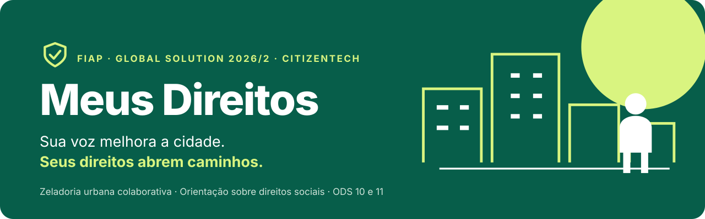
</p>

<p align="center">
  <a href=".github/workflows/ci.yml"></a>
  
  
  
  
  
  
</p>

<p align="center">
  <a href="#o-que-é">O que é</a> ·
  <a href="#telas">Telas</a> ·
  <a href="#funcionalidades">Funcionalidades</a> ·
  <a href="#como-executar">Como executar</a> ·
  <a href="#arquitetura">Arquitetura</a> ·
  <a href="#documentação">Documentação</a> ·
  <a href="#integrantes">Integrantes</a>
</p>

---

## O que é

O **Meus Direitos** é um app de celular que junta **zeladoria urbana colaborativa** e **orientação sobre direitos sociais**, em linguagem simples.

<table>
  <tr>
    <td width="50%" valign="top">
      <br>
      <strong>Cidade</strong><br>
      Moradores registram problemas do bairro (buracos, calçadas, iluminação, limpeza, segurança), apoiam as denúncias dos vizinhos, conversam sobre elas e confirmam juntos quando foram resolvidas. O feed prioriza o que mais afeta cada pessoa.
    </td>
    <td width="50%" valign="top">
      <br>
      <strong>Meus Direitos</strong><br>
      Um questionário opcional indica possibilidades de apoio (gratuidades, atendimento prioritário, benefícios municipais, cotas), os passos para buscá-las e os canais oficiais para confirmar: a prefeitura da cidade, o Gov.br e os CRAS mais próximos.
    </td>
  </tr>
</table>

**Por que importa.** Problemas do bairro se perdem em canais que ninguém acompanha, e quem mais precisa de um direito costuma ser quem menos sabe que ele existe. O app atende aos **ODS 10** (Redução das desigualdades) e **11** (Cidades e comunidades sustentáveis).

🎥 **Vídeo pitch:** _link será adicionado na entrega_

## Telas

<p align="center">
  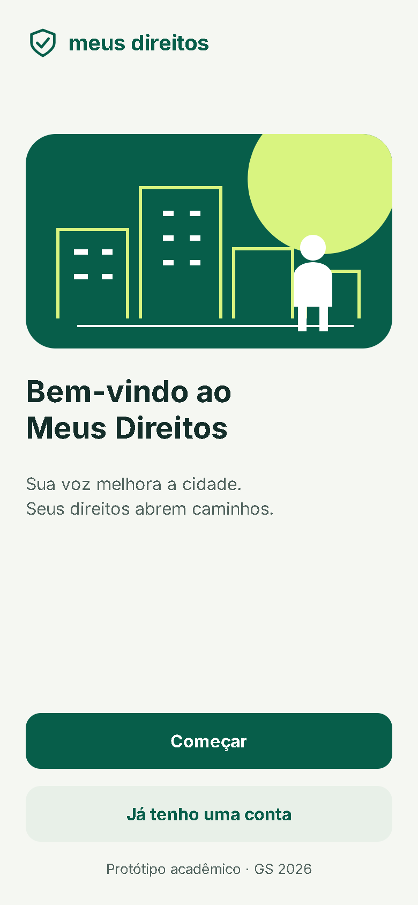
  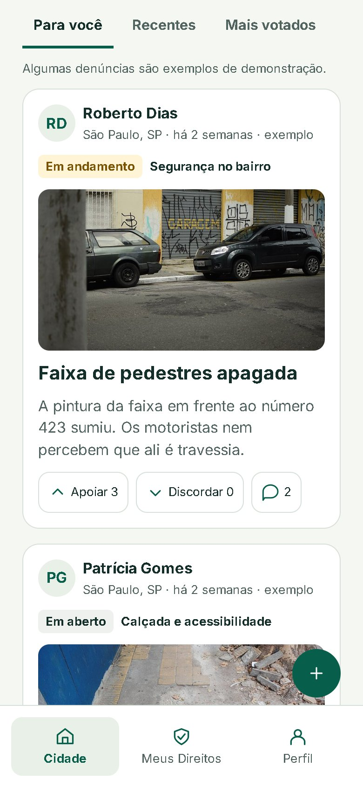
  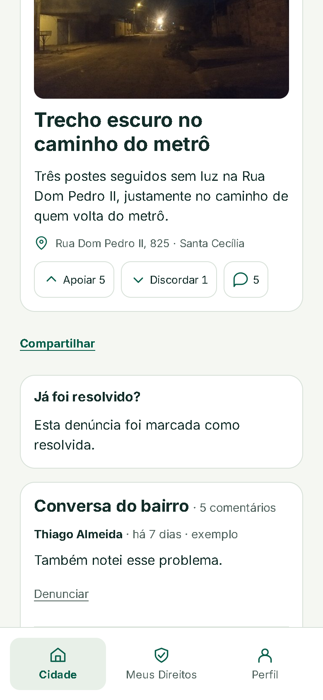
  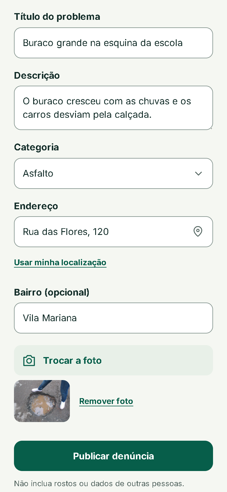
  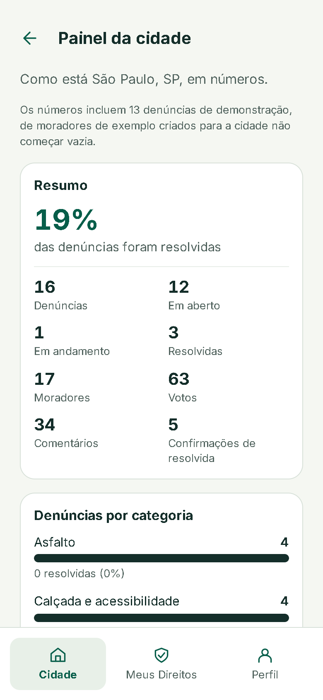
</p>
<p align="center">
  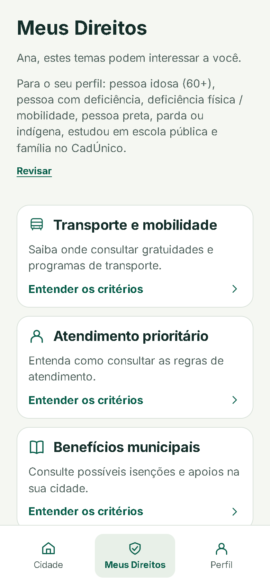
  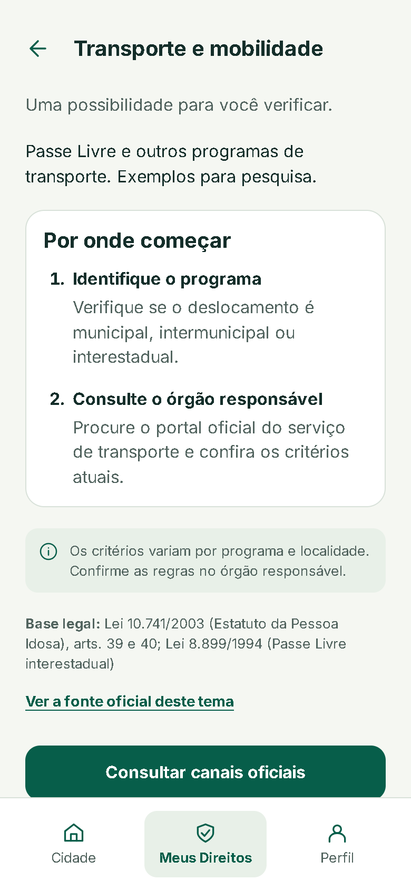
  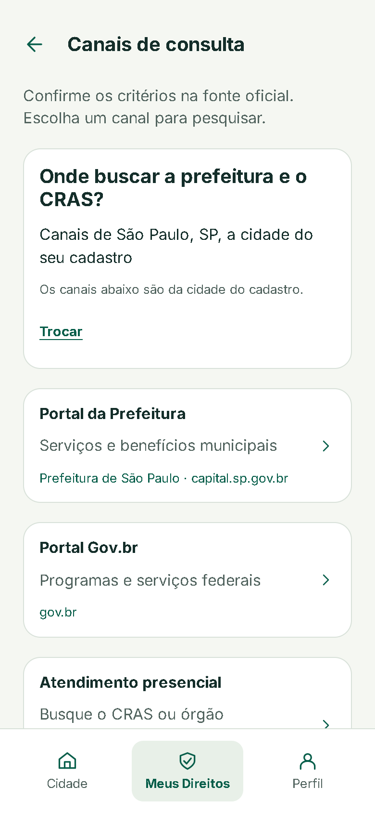
  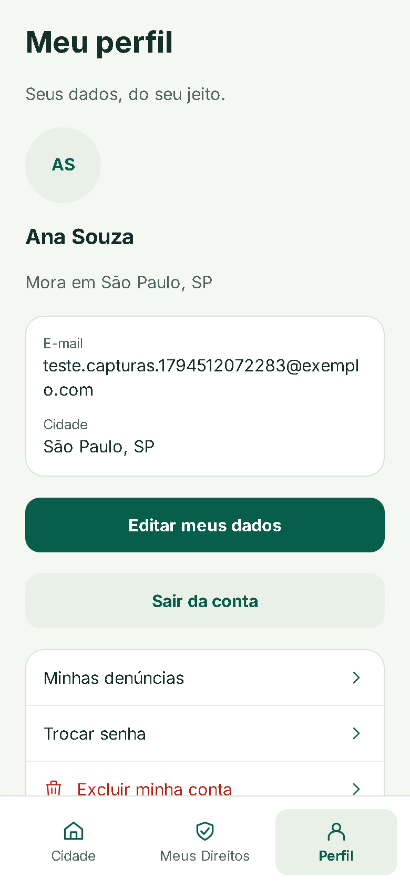
</p>

<details>
<summary><strong>No computador</strong></summary>
<br>
<p align="center">
  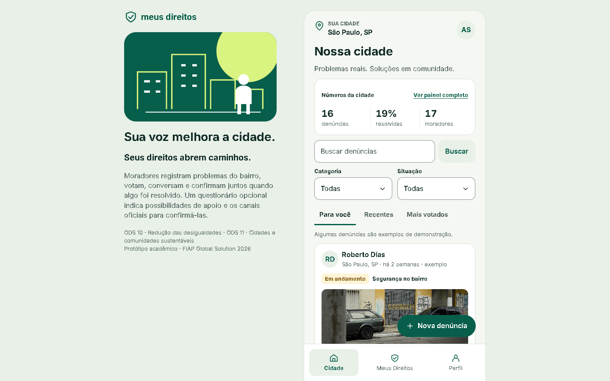
</p>
</details>

O protótipo segue o Figma da equipe: verde `#075E4A`, tinta `#142E2A`, verde-limão `#D9F480`, fundo `#F5F7F2` e a fonte Inter.

## Funcionalidades

| | Funcionalidade | Destaques |
|---|---|---|
|  | **Feed da cidade** | Abas "Para você", "Recentes" e "Mais votados"; busca por texto e filtros de categoria e situação; selo "Exemplo" no conteúdo de demonstração |
| | **Denúncias** | Nova denúncia em etapas, com foto de demonstração e "Usar minha localização" para o endereço; protocolo; editar, excluir, marcar como resolvida e reabrir |
|  | **Comunidade** | Apoiar ou discordar (voto otimista), conversa do bairro, resolução confirmada por 3 moradores, denunciar comentário ofensivo, compartilhar |
| | **Painel da cidade** | Resumo, denúncias por categoria, bairros com mais problemas e denúncias com mais participação |
|  | **Meus Direitos** | Questionário opcional em 3 etapas com consentimento (LGPD), temas indicados pelo perfil, catálogo com todos os temas (filtro por público), passos práticos e canais oficiais pela localização ou pela cidade do cadastro |
|  | **Perfil** | Minhas denúncias com avisos de novidades, editar dados, trocar senha e excluir a conta com tudo o que foi criado |

**Em todas as telas:** validação em JavaScript com as mesmas regras da API, mensagens ao lado de cada campo, navegação por teclado e leitor de tela, alvos de toque de 44 px e respeito a `prefers-reduced-motion`.

**Para o avaliador nunca ver um app vazio**, a primeira pessoa de cada cidade recebe uma "cidade viva": moradores e denúncias de exemplo, sempre identificados como tal.

## Como executar

Pré-requisitos: **JDK 17**, **Maven 3.9+**, acesso ao **Oracle da FIAP** e um navegador. O Node 22 só é necessário para desenvolver o front.

**1. Banco de dados.** No SQL Developer, abra [`database/script.sql`](database/script.sql) e execute com **F5**. O script só cria o que ainda não existe, e por isso pode rodar num schema compartilhado ([guia do banco](docs/banco-de-dados.md)).

**2. API.**

```bash
cd backend
cp db.properties.example db.properties   # preencha db.usuario, db.senha e token.segredo
mvn clean compile exec:java              # API em http://localhost:8080/api
```

O modelo já libera `cors.origens=http://localhost:5173,null`: a origem `null` é a do `index.html` aberto direto do disco. Se mudar a lista, mantenha o `null`.

**3. App.** Com a API rodando, abra **`frontend/dist/index.html`** com um duplo clique. A pasta `dist/` já vem pronta.

<details>
<summary>Rodar o front em modo de desenvolvimento</summary>

```bash
cd frontend
npm install
npm run dev        # http://localhost:5173
npm run build      # gera de novo a pasta dist/
```

Para apontar para outra API, defina `VITE_API_URL` (detalhes no [README do front-end](frontend/README.md)).
</details>

## Testes

| Tipo | Comando | Banco |
|---|---|---|
| Unidade do back-end | `mvn test` (pasta `backend/`) | Não precisa |
| Integração dos DAOs | `MD_INTEGRACAO=true mvn test -Dtest=DaosIntegracaoTest` | Oracle; tudo é desfeito com ROLLBACK |
| Ponta a ponta da API | `node testes/api-ponta-a-ponta.mjs` (com a API no ar) | Oracle; as contas de teste são excluídas no fim |
| Manual | Coleção do Insomnia em [`docs/insomnia/`](docs/insomnia/meus-direitos.insomnia.json) | Oracle |

A [CI](.github/workflows/ci.yml) roda os testes do back-end e o build do front-end a cada push.

## Arquitetura

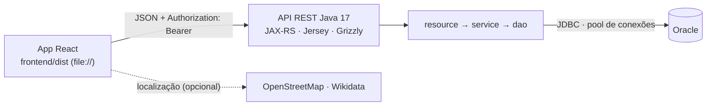

| Camada | Tecnologias |
|---|---|
| Front-end | React 19, React Router 7 (HashRouter), Vite 8, Bootstrap 5 (reset e utilitários), JavaScript, HTML5, CSS3 |
| Back-end | Java 17, Maven, JAX-RS (Jersey 4), Grizzly, JSON-B, JDBC, JUnit 5 |
| Banco de dados | Oracle Database (ojdbc8) |
| Qualidade | GitHub Actions, testes de unidade, integração e ponta a ponta |

Sem frameworks além dos da disciplina: o token de sessão (HMAC-SHA256), o pool de conexões e as transações são feitos com o próprio JDK. O porquê de cada decisão está na [arquitetura](docs/arquitetura.md).

## Estrutura do repositório

```
meus-direitos/
├── backend/            API REST (Java 17, JAX-RS, JDBC)
├── frontend/           App React; dist/ é o build que abre direto no navegador
├── database/           script.sql: tabelas, índices e catálogo inicial de direitos
├── docs/               arquitetura, API, banco, segurança, diagramas, Insomnia e roteiro
├── testes/             teste de ponta a ponta da API (Node, sem dependências)
├── AGENTS.md           guia para agentes de IA
├── CONTRIBUTING.md     como contribuir (commits, testes, checklist)
└── CHANGELOG.md        histórico das entregas
```

## Documentação

| Documento | Para quê |
|---|---|
| [Índice da documentação](docs/README.md) | Qual documento ler para cada objetivo |
| [Arquitetura](docs/arquitetura.md) | Como as peças se encaixam, regras do produto e decisões |
| [Guia da API](docs/api.md) | Todas as rotas, corpos, respostas e erros |
| [Banco de dados](docs/banco-de-dados.md) e [diagrama ER](docs/diagramas/diagrama-er.md) | Script, tabelas, convenções e como evoluir o banco |
| [Segurança e privacidade](docs/seguranca-e-privacidade.md) | Dados pessoais, LGPD e proteções da API |
| [README do back-end](backend/README.md) e [diagrama de classes](docs/diagramas/diagrama-classes.md) | Configuração, pacotes, decisões e limitações da API |
| [README do front-end](frontend/README.md) e [diagrama do front](docs/diagramas/diagrama-frontend.md) | Rotas, componentes, tokens de design, acessibilidade e créditos |
| [Roteiro de demonstração](docs/roteiro-demonstracao.md) | Como gravar o vídeo pitch ou apresentar |
| [Deploy](docs/deploy.md) | Como publicar a API no Render e o app na Vercel |
| [Como contribuir](CONTRIBUTING.md) · [Guia para agentes de IA](AGENTS.md) · [Histórico](CHANGELOG.md) | Trabalhar no projeto |

## Uso de IA generativa

O grupo usou o **Claude (Anthropic)**, via Claude Code, como apoio no back-end e no front-end: análise do enunciado, planejamento, geração e revisão de código, testes, auditoria de acessibilidade e documentação. O design é da equipe, e todo o código foi revisado, compreendido e testado pelos integrantes. Os detalhes estão nas seções "Uso de IA generativa" do [README do back-end](backend/README.md) e do [README do front-end](frontend/README.md).

## Créditos

- Protótipo no Figma pela equipe de front-end.
- Fotos de demonstração do [Wikimedia Commons](https://commons.wikimedia.org/), com autores e licenças listados no [README do front-end](frontend/README.md).
- Fonte [Inter](https://rsms.me/inter/) (licença SIL Open Font License), hospedada no próprio projeto.
- Mapas e dados de localização do [OpenStreetMap](https://www.openstreetmap.org/copyright) e do [Wikidata](https://www.wikidata.org/).

## Integrantes

| Nome | RM | Frente |
|---|---|---|
| João Ricardo | _RM_ | Back-end |
| Caio | _RM_ | Back-end |
| Marcela | _RM_ | Front-end |
| Bielecky | _RM_ | Front-end |
| Vicentini | _RM_ | Banco de dados |

<p align="center">
  <br>
  <br>
  <sub>Meus Direitos · FIAP Global Solution 2026/2 · CitizenTech</sub>
</p>
