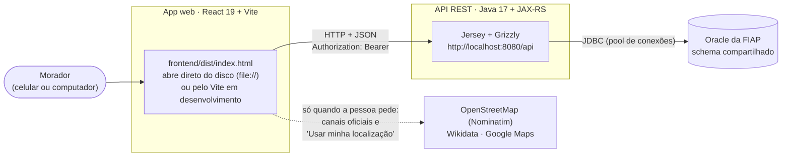
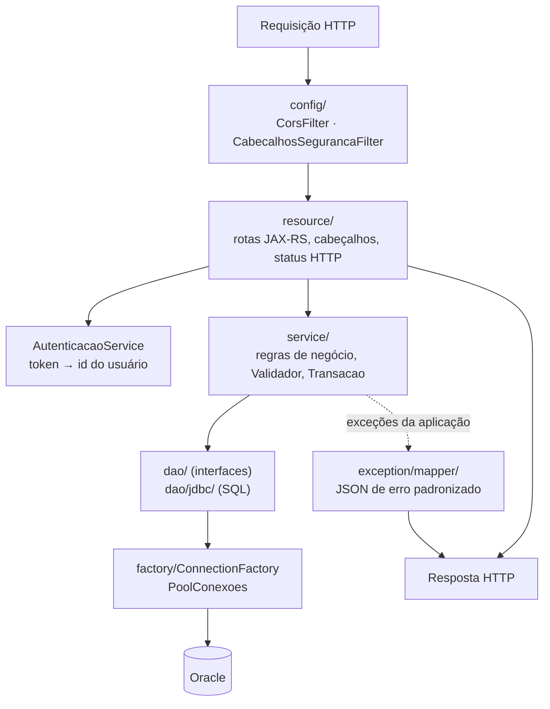
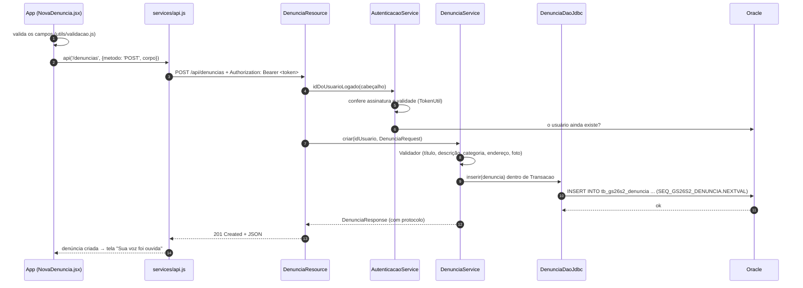

# Arquitetura

Visão geral do sistema: as peças, como uma requisição passa por elas, as regras centrais do produto e as decisões que moldaram o código. Os detalhes de cada lado estão no [README do back-end](../backend/README.md), no [README do front-end](../frontend/README.md) e nos [diagramas](diagramas/).

## 1. Visão de contexto



| Peça | Tecnologia | Responsabilidade |
|---|---|---|
| App web | React 19, React Router 7 (HashRouter), Bootstrap 5 (só reset e utilitários), Vite 8 | Telas do Figma, validação dos formulários, sessão no navegador |
| API REST | Java 17, Jersey 4 (JAX-RS), Grizzly, JSON-B | Regras de negócio, autenticação, validação, relatórios, conteúdo de demonstração |
| Banco | Oracle (ojdbc8 23.2) | Persistência; integridade por chaves, `CHECK` e `UNIQUE` |
| Serviços externos | Nominatim, Wikidata, Google Maps | Encontrar a cidade, o portal da prefeitura e os CRAS próximos (chamados pelo navegador, não pela API) |

## 2. Camadas do back-end



- **Resource** só traduz HTTP: lê caminho, query e cabeçalhos, chama o service e escolhe o status (`201` com `Location`, `204`…).
- **Service** valida (`Validador` acumula os erros de todos os campos), aplica as regras e controla a transação com `Transacao.executar(con -> ...)`, que faz COMMIT no fim ou ROLLBACK se algo lançar exceção.
- **DAO** recebe a `Connection` aberta pelo service e só executa SQL com `PreparedStatement`. Nunca faz COMMIT.
- **Erros** são exceções da aplicação (`ValidacaoException` 400, `NaoAutenticadoException` 401, `AcessoNegadoException` 403, `EntidadeNaoEncontradaException` 404, `ConflitoException` 409, `RegraNegocioException` 422, `MuitasTentativasException` 429, `PersistenciaException` 503 ou conforme o erro do Oracle). Os mappers devolvem sempre o mesmo formato de JSON (ver [§6 do guia da API](api.md#6-erros)).

## 3. O caminho de uma requisição

Exemplo: uma pessoa logada publica uma denúncia.



Se a validação falhar, a API responde 400 com a lista `campos`, e o front mostra cada mensagem ao lado do campo. Se o token tiver vencido, a resposta é 401: o front apaga a sessão e volta para "Entrar".

## 4. Regras centrais do produto

### 4.1 Feed "Para você"

O feed mostra as denúncias da cidade de quem está logado. Na aba **Para você**, cada denúncia recebe uma relevância calculada no próprio SQL (`FeedService` e `DenunciaDaoJdbc.feed`):

```
relevância = saldo de votos (apoios − discordâncias)
           + 10  se a categoria afeta o perfil de quem lê
           − 15  se a denúncia já foi resolvida
```

O perfil vem do questionário opcional (`PerfilDemografico.calcularTags`):

| Tag | Quando | Categorias que ficam mais relevantes |
|---|---|---|
| `IDOSO` | 60 anos ou mais | Iluminação, Calçada e acessibilidade, Segurança no bairro |
| `PCD` | Alguma deficiência | Iluminação, Calçada e acessibilidade |
| `PCD_MOBILIDADE` | Deficiência física | Calçada e acessibilidade |
| `JOVEM`, `PPI`, `ESCOLA_PUBLICA`, `BAIXA_RENDA` | 15 a 29 anos; preta, parda ou indígena; escola pública; CadÚnico | Usadas para indicar os temas de direitos |

Sem questionário, "Para você" ordena só pelos votos. As abas **Recentes** e **Mais votados** não usam o perfil.

### 4.2 Resolução pela comunidade

Uma denúncia é resolvida de dois jeitos:

1. O **autor** marca como resolvida (e pode reabrir).
2. **Três moradores diferentes da mesma cidade** confirmam "Já foi resolvido". Na terceira confirmação, a situação muda sozinha para Resolvida.

O autor não confirma a própria denúncia, e reabrir zera as confirmações.

### 4.3 Meus Direitos

O questionário tem três etapas, e todas as perguntas podem ser puladas. As respostas viram tags (tabela acima), e cada tema do catálogo (`TB_GS26S2_DIREITO`) declara a quais tags se aplica (`TB_GS26S2_DIREITO_TAG`). A tela mostra os temas cujas tags a pessoa tem, com passos práticos e o link oficial para confirmar. O app **não afirma que a pessoa tem o direito**: ele indica possibilidades e onde confirmar.

### 4.4 "Cidade viva" (conteúdo de demonstração)

Para o app nunca parecer vazio na avaliação, a primeira conta de uma cidade dispara a criação de 12 moradores de exemplo e 12 denúncias com votos, comentários e confirmações (`service/simulacao/`, a partir de `simulacao.json`). Ao abrir o feed, se já passaram 10 minutos, surgem algumas novidades. O conteúdo de exemplo:

- é marcado no banco (`st_simulado = 'S'`) e no app (selo "Exemplo");
- não faz login, não aparece nas listas públicas de usuários e nunca interage com denúncias de pessoas reais;
- aparece nos relatórios com a contagem separada (`denunciasSimuladas`), por transparência.

### 4.5 Moderação

Comentários com termos ofensivos comuns são recusados (filtro simples por palavra inteira). Qualquer pessoa logada pode reportar o comentário de outra; com **3 reportes** ele some da conversa e das contagens, sem ser apagado do banco, e não pode mais ser editado nem reportado (o autor ainda pode excluí-lo).

## 5. Decisões de arquitetura

Cada decisão com o motivo e o que se abriu mão.

| # | Decisão | Por quê | Custo aceito |
|---|---|---|---|
| 1 | **JAX-RS + JDBC puro**, sem Spring nem JPA | Regra da FIAP: só pontuam as tecnologias da disciplina | Mais código de infraestrutura (transação, pool, mapeamento) |
| 2 | **Camadas resource → service → dao** com interfaces nos DAOs | Separar HTTP, regra e SQL; testar regras sem banco | Mais arquivos por funcionalidade |
| 3 | **Token assinado com HMAC-SHA256** feito com `javax.crypto` | Sem biblioteca de JWT; não precisa de tabela de sessões | O token não pode ser revogado antes de vencer (7 dias), exceto excluindo a conta |
| 4 | **Pool de conexões próprio** (`BlockingQueue` + `Semaphore`; a `Transacao` empresta e devolve no `finally`) | Abrir conexão com o Oracle da FIAP custa centenas de milissegundos | Pool simples: tamanho fixo, sem métricas |
| 5 | **Script do banco que só cria o que falta, com objetos no padrão `GS26S2`** | O schema é compartilhado com outros projetos | Mudanças de coluna exigem um bloco novo e cuidadoso |
| 6 | **Sem `ON DELETE CASCADE`**: o service apaga as filhas antes | Exclusões explícitas e revisáveis; se algo escapar, o Oracle recusa (ORA-02292) em vez de apagar em silêncio | Toda tabela filha nova precisa entrar nas rotinas de exclusão |
| 7 | **Cidade como texto**, comparada sem acento e maiúsculas, com índice baseado em função | Cadastro simples, sem tabela de municípios | Grafias muito diferentes ("S. Paulo") não se encontram |
| 8 | **HashRouter + build IIFE + `base: './'`** | A entrega da FIAP abre o `index.html` direto do disco | URLs com `#`; a origem `null` precisa estar no CORS |
| 9 | **Fotos só de demonstração** (sem upload) | Sem armazenamento de arquivos no escopo; evita conteúdo impróprio e links externos | A pessoa escolhe entre fotos prontas |
| 10 | **Localização no navegador**, não na API | A posição da pessoa não passa pelo nosso servidor | Depende de serviços externos gratuitos (Nominatim) e da permissão do navegador |
| 11 | **Conteúdo de demonstração gerado pela API** | O avaliador vê o produto funcionando em qualquer cidade | Dados de exemplo e reais convivem nas mesmas tabelas (separados por `st_simulado`) |

## 6. Onde está cada coisa

| Assunto | Documento |
|---|---|
| Rotas, corpos, respostas e erros | [`api.md`](api.md) |
| Classes do back-end | [`diagramas/diagrama-classes.md`](diagramas/diagrama-classes.md) |
| Tabelas e regras do banco | [`diagramas/diagrama-er.md`](diagramas/diagrama-er.md) e [`banco-de-dados.md`](banco-de-dados.md) |
| Telas e camadas do front | [`diagramas/diagrama-frontend.md`](diagramas/diagrama-frontend.md) |
| Segurança e LGPD | [`seguranca-e-privacidade.md`](seguranca-e-privacidade.md) |
