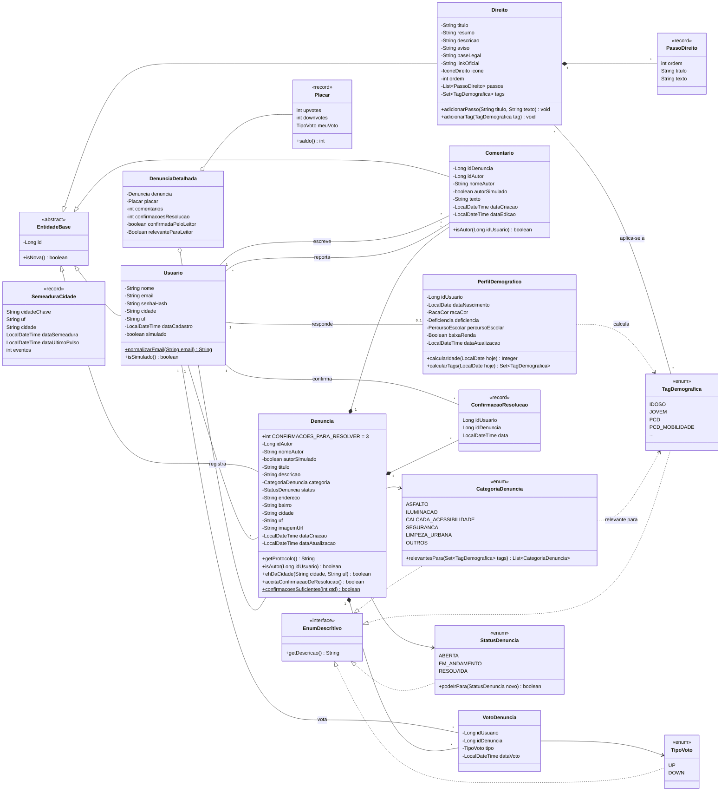
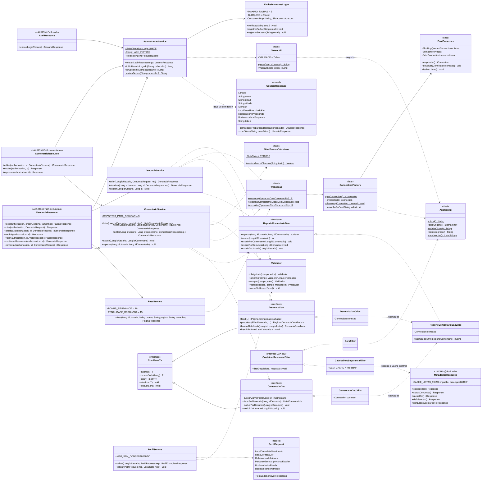
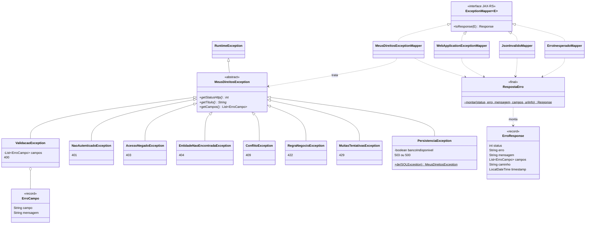

# Diagrama de classes · back-end

Gerado a partir do código em `backend/src/main/java/br/com/fiap/meusdireitos`.
O GitHub desenha os diagramas abaixo direto nesta página. As versões em imagem estão em `diagrama-classes-*.svg`, nesta mesma pasta.

O diagrama está dividido em três partes:
1. **Domínio:** as entidades e as regras que ficam nelas.
2. **Camadas:** como uma requisição atravessa resource → service → DAO → Oracle, com a autenticação por token, a moderação dos comentários e os filtros de resposta.
3. **Erros:** a hierarquia de exceções e os mappers que garantem a resposta padronizada.

Getters e setters foram omitidos.

## 1. Domínio (`model`)

> Também implementam `EnumDescritivo`: `RacaCor`, `Deficiencia`, `PercursoEscolar`, `IconeDireito` e `OrdemFeed`.
>
> O reporte de comentário (associação "reporta") não tem classe no modelo: é só a tabela `TB_GS26S2_REPORTE_COMENTARIO` (usuário, comentário, data), acessada pelo `ReporteComentarioDao`. Com 3 reportes, o comentário deixa de aparecer na listagem e nas contagens. `SemeaduraCidade` registra as cidades que já receberam o conteúdo de demonstração ("cidade viva").

## 2. Camadas (exemplo: denúncias e comentários)

O mesmo padrão se repete para usuários, votos, direitos, perfil e relatórios: o resource cuida do HTTP, o service das regras e da transação, e o DAO do SQL.

Como ler:
- **Autenticação.** Toda rota 🔒 chama `AutenticacaoService.idDoUsuarioLogado(Authorization)`: tira o `Bearer`, valida o token no `TokenUtil` (HMAC-SHA256 com `AppConfig.tokenSegredo()`, validade de 7 dias) e confere se o usuário ainda existe. Rotas públicas usam `idOpcional`, que nunca lança erro (token inválido ou de conta excluída vira visitante). O login passa antes pelo `LimiteTentativasLogin` (5 falhas seguidas no mesmo e-mail bloqueiam por 15 minutos, HTTP 429) e devolve o `UsuarioResponse` com `comToken(...)`.
- **Moderação.** `ComentarioService` recusa texto com termo ofensivo (`FiltroTermosOfensivos`, 400 em `texto`) e grava reportes pelo `ReporteComentarioDao`. Os DAOs que listam e contam comentários usam `ReporteComentarioDaoJdbc.naoOculto(...)`, a condição SQL "menos de 3 reportes"; editar e reportar buscam o comentário com `buscarVisivelPorId`, que aplica a mesma condição (oculto = 404). Ao excluir comentário, denúncia ou conta, os reportes ligados são apagados antes, na mesma transação.
- **Consentimento.** `PerfilRequest.temDadoSensivel()` diz se veio algum dado sensível; nesse caso `PerfilService.validar` exige `consentimento == true` (400 no campo `consentimento`).
- **Conexões.** `Transacao` pede a conexão à `ConnectionFactory`, que a empresta do `PoolConexoes` (até `MD_DB_POOL` conexões, padrão 5). A `Transacao` devolve a conexão com `ConnectionFactory.devolver` num bloco `finally`.
- **Filtros de resposta.** `CorsFilter` e `CabecalhosSegurancaFilter` implementam `ContainerResponseFilter` e agem em toda resposta. O segundo põe `Cache-Control: no-store`, exceto quando a rota já definiu o seu, como as listas fixas do `MetadadosResource` (`public, max-age=86400`).

> DAOs que estendem `CrudDao<T>`: `UsuarioDao`, `DenunciaDao`, `ComentarioDao` e `DireitoDao`. Os demais (`VotoDenunciaDao`, `ConfirmacaoResolucaoDao`, `ReporteComentarioDao`, `PerfilDemograficoDao`, `RelatorioDao`, `SemeaduraCidadeDao`) têm operações próprias. Cada um tem a sua implementação `*DaoJdbc`, que recebe a `Connection` aberta pela `Transacao`.

## 3. Erros (`exception`)

O `getStatusHttp()` é polimórfico: o `MeusDireitosExceptionMapper` não tem nenhum `if`. Cada exceção sabe o seu status. Os quatro mappers usam o mesmo `RespostaErro.montar(...)`, que preenche o `ErroResponse` com a rota chamada (`caminho`) e o momento do erro.

| Mapper | Trata | Status |
|---|---|---|
| `MeusDireitosExceptionMapper` | Exceções da aplicação | O da exceção (400, 401, 403, 404, 409, 422, 429, 500 ou 503) |
| `JsonInvalidoMapper` | JSON malformado, enum inexistente, data inválida (`ProcessingException` do JSON-B) | 400 |
| `WebApplicationExceptionMapper` | Erros do Jersey: rota inexistente, método ou `Content-Type` errado | O original (404, 405, 415…), mantendo o cabeçalho `Allow` |
| `ErroInesperadoMapper` | Qualquer outro `Throwable` | 500, sem stack trace na resposta |

A `MuitasTentativasException` (429) é lançada pelo `LimiteTentativasLogin` quando o e-mail está bloqueado.

O `PersistenciaException.de` traduz o código do Oracle para a exceção certa:

| Código do Oracle | Significado | Exceção (status) |
|---|---|---|
| ORA-00001 | registro duplicado | `ConflitoException` (409) |
| ORA-02292 | registro com vínculos | `ConflitoException` (409) |
| ORA-02291 | registro relacionado inexistente | `EntidadeNaoEncontradaException` (404) |
| ORA-01400, ORA-02290, ORA-12899 | obrigatório, valor não permitido, valor grande demais | `ValidacaoException` (400) |
| Erro de conexão (ORA-12541, ORA-12514, ORA-12505, ORA-01017, ORA-28000, ORA-17002, SQLState `08…`) | banco fora do ar | `PersistenciaException` (503) |
| Pool sem conexão livre depois de 10 s (SQLState `08001`) | todas as conexões em uso | `PersistenciaException` (503) |
| Outros | — | `PersistenciaException` (500) |
