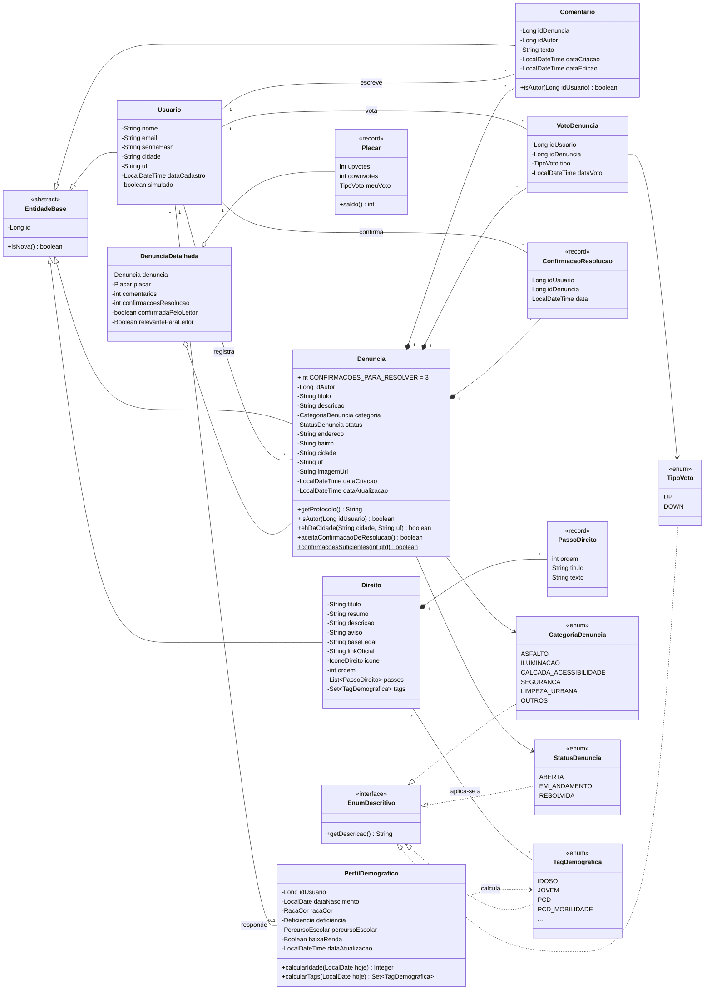
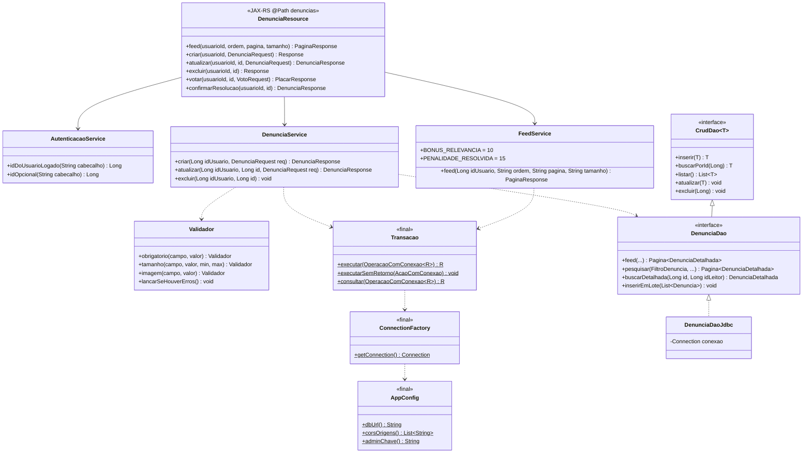
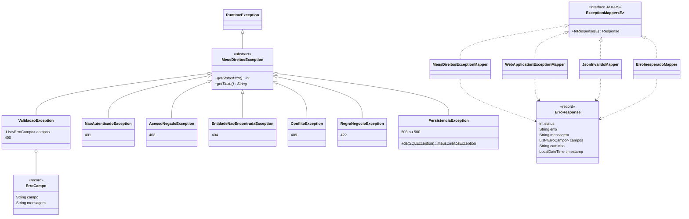

# Diagrama de classes · back-end

Gerado a partir do código em `backend/src/main/java/br/com/fiap/meusdireitos`.
O GitHub desenha os diagramas abaixo direto nesta página. As versões em imagem estão em `diagrama-classes-*.svg`, nesta mesma pasta.

O diagrama está dividido em três partes:
1. **Domínio:** as entidades e as regras que ficam nelas.
2. **Camadas:** como uma requisição atravessa resource → service → DAO → Oracle.
3. **Erros:** a hierarquia de exceções e os mappers que garantem a resposta padronizada.

Getters e setters foram omitidos.

## 1. Domínio (`model`)

> Também implementam `EnumDescritivo`: `RacaCor`, `Deficiencia`, `PercursoEscolar`, `IconeDireito` e `OrdemFeed`.

## 2. Camadas (exemplo: denúncias)

O mesmo padrão se repete para usuários, comentários, votos, direitos, perfil e relatórios.

> DAOs que estendem `CrudDao<T>`: `UsuarioDao`, `DenunciaDao`, `ComentarioDao` e `DireitoDao`. Os demais (`VotoDenunciaDao`, `ConfirmacaoResolucaoDao`, `PerfilDemograficoDao`, `RelatorioDao`, `SemeaduraCidadeDao`) têm operações próprias. Cada um tem a sua implementação `*DaoJdbc`, que recebe a `Connection` aberta pela `Transacao`.

## 3. Erros (`exception`)

O `getStatusHttp()` é polimórfico: o `MeusDireitosExceptionMapper` não tem nenhum `if`. Cada exceção sabe o seu status.

O `PersistenciaException.de` traduz o código do Oracle para a exceção certa:

| Código do Oracle | Significado | Exceção (status) |
|---|---|---|
| ORA-00001 | registro duplicado | `ConflitoException` (409) |
| ORA-02292 | registro com vínculos | `ConflitoException` (409) |
| ORA-02291 | registro relacionado inexistente | `EntidadeNaoEncontradaException` (404) |
| ORA-01400, ORA-02290, ORA-12899 | obrigatório, valor não permitido, valor grande demais | `ValidacaoException` (400) |
| Erro de conexão (ORA-12541, ORA-12514, ORA-01017…) | banco fora do ar | `PersistenciaException` (503) |
| Outros | — | `PersistenciaException` (500) |
