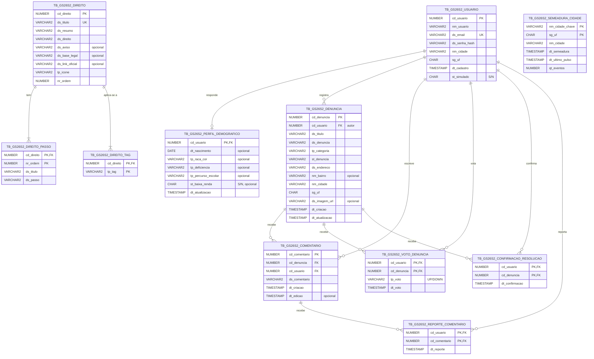

# Modelo de dados (diagrama ER)

Gerado a partir de [`database/script.sql`](../../database/script.sql), que cria estas tabelas no Oracle.
O GitHub desenha o diagrama abaixo direto nesta página.

## Diagrama

`TB_GS26S2_SEMEADURA_CIDADE` não tem chave estrangeira: ela registra quais cidades já receberam o conteúdo de demonstração ("cidade viva") e quando foi o último pulso de atividade. A ligação com usuários e denúncias é pelo nome da cidade e pela UF.

## Regras garantidas pelo banco

| Regra | Como |
|---|---|
| Um e-mail por conta | `UNIQUE (ds_email)` em `tb_gs26s2_usuario` (a API responde 409) |
| Um voto por pessoa em cada denúncia | Chave primária `(cd_usuario, cd_denuncia)` em `tb_gs26s2_voto_denuncia` |
| Uma confirmação de resolução por pessoa | Chave primária `(cd_usuario, cd_denuncia)` em `tb_gs26s2_confirmacao_resolucao` |
| Um reporte por pessoa em cada comentário | Chave primária `(cd_usuario, cd_comentario)` em `tb_gs26s2_reporte_comentario` (reportar de novo não conta duas vezes) |
| Questionário opcional, no máximo um por usuário | `cd_usuario` é a chave primária e estrangeira de `tb_gs26s2_perfil_demografico` |
| Título de tema sem repetição | `UNIQUE (ds_titulo)` em `tb_gs26s2_direito` (a API também compara sem diferenciar maiúsculas antes de gravar) |
| Uma semeadura por cidade | Chave primária `(nm_cidade_chave, sg_uf)` em `tb_gs26s2_semeadura_cidade` |
| Valores de lista válidos | `CHECK` em categoria, status, voto, raça/cor, deficiência, percurso escolar, ícone e tag, com os mesmos valores dos enums Java (a UF é validada pela API) |
| Passos numerados de 1 a 10 | `CHECK (nr_ordem BETWEEN 1 AND 10)` em `tb_gs26s2_direito_passo` |
| Booleanos | `CHAR(1)` com `CHECK IN ('S', 'N')` |

## Índices

As chaves primárias e únicas já criam os seus índices (`PK_*`, `UK_GS26S2_USUARIO_EMAIL`, `UK_GS26S2_DIREITO_TITULO`). O script cria também estes, cada um só se ainda não existir:

| Índice | Tabela (colunas) | Para quê |
|---|---|---|
| `IX_GS26S2_COMENTARIO_DENUNCIA` | `TB_GS26S2_COMENTARIO (CD_DENUNCIA)` | Listar e contar os comentários de uma denúncia |
| `IX_GS26S2_COMENTARIO_USUARIO` | `TB_GS26S2_COMENTARIO (CD_USUARIO)` | Apagar os comentários de quem exclui a conta |
| `IX_GS26S2_CONFIRMACAO_RESOLUCAO_DENUNCIA` | `TB_GS26S2_CONFIRMACAO_RESOLUCAO (CD_DENUNCIA)` | Contar as confirmações de resolução de uma denúncia |
| `IX_GS26S2_DENUNCIA_CIDADE` | `TB_GS26S2_DENUNCIA (NM_CIDADE, SG_UF)` | Consultas pela cidade exata |
| `IX_GS26S2_DENUNCIA_USUARIO` | `TB_GS26S2_DENUNCIA (CD_USUARIO)` | "Minhas denúncias" e exclusão da conta |
| `IX_GS26S2_DIREITO_TAG_TAG` | `TB_GS26S2_DIREITO_TAG (TP_TAG)` | Temas aplicáveis a um perfil (`/direitos/meus`) |
| `IX_GS26S2_USUARIO_SIMULADO` | `TB_GS26S2_USUARIO (ST_SIMULADO, SG_UF)` | Separar moradores de exemplo das pessoas reais |
| `IX_GS26S2_VOTO_DENUNCIA_DENUNCIA` | `TB_GS26S2_VOTO_DENUNCIA (CD_DENUNCIA)` | Placar de votos de uma denúncia |
| `IX_GS26S2_REPORTE_COMENTARIO_COMENTARIO` | `TB_GS26S2_REPORTE_COMENTARIO (CD_COMENTARIO)` | Contar os reportes de um comentário (ocultar com 3) |
| `IX_GS26S2_DENUNCIA_CIDADE_CHAVE` | `TB_GS26S2_DENUNCIA (TRANSLATE(UPPER(TRIM(nm_cidade)), …), SG_UF)` | Feed, busca e relatórios pela cidade, sem acento nem maiúsculas (baseado em função) |
| `IX_GS26S2_USUARIO_CIDADE_CHAVE` | `TB_GS26S2_USUARIO (TRANSLATE(UPPER(TRIM(nm_cidade)), …), SG_UF)` | Contar usuários da cidade e achar os moradores de exemplo dela (baseado em função) |

Os dois últimos usam exatamente a expressão gerada por `JdbcUtil.cidadeIgual` no back-end (o teste `IndiceCidadeScriptTest` confere isso). Se o Oracle recusar um deles, o script só registra o aviso e continua: a API funciona igual, sem o índice.

## Decisões

- **Padrão de nomes `GS26S2`.** Tabelas, sequences, chaves e índices levam `GS26S2` depois do prefixo do tipo (`TB_GS26S2_USUARIO`, `FK_GS26S2_DENUNCIA_USUARIO`), para identificar o projeto no schema compartilhado. As colunas não levam o prefixo.
- **Script que só cria o que falta.** O `database/script.sql` reproduz exatamente as tabelas do schema usado no Oracle da FIAP e nunca apaga nada (a etapa 0 só renomeia objetos antigos para o padrão): cada tabela, sequence e índice só é criado se ainda não existir, e cada tema do catálogo só é inserido se o título ainda não estiver cadastrado. Assim ele pode rodar num schema compartilhado com outros projetos.
- **Comentário oculto por reportes, sem apagar.** Com 3 linhas em `tb_gs26s2_reporte_comentario` o comentário deixa de aparecer na API e de contar nos totais, mas continua no banco (a contagem é uma subconsulta, sem coluna de status).
- **Datas com hora em `TIMESTAMP`** com `DEFAULT SYSTIMESTAMP`; a data de nascimento é `DATE`.
- **Textos em `VARCHAR2` com o limite padrão do schema (em bytes).** A API valida os tamanhos em caracteres. Um texto no limite máximo e cheio de acentos pode passar de bytes: nesse caso o Oracle recusa (ORA-12899) e a API responde 400 indicando o campo.
- **Sem `ON DELETE CASCADE`.** A API apaga as tabelas filhas antes da tabela mãe, na mesma transação. Se algo escapar, o Oracle recusa a exclusão (ORA-02292) e a API responde 409 em vez de apagar dados em silêncio.
- **Chaves geradas por sequence** (`seq_gs26s2_usuario`, `seq_gs26s2_denuncia`, `seq_gs26s2_comentario`, `seq_gs26s2_direito`), usadas pela API com `NEXTVAL`.
- **Cidade guardada como texto.** A comparação ignora acentos e maiúsculas (`TRANSLATE(UPPER(TRIM(...)))` nas consultas), e a API junta os espaços repetidos antes de gravar. Os índices baseados em função `IX_GS26S2_DENUNCIA_CIDADE_CHAVE` e `IX_GS26S2_USUARIO_CIDADE_CHAVE` usam exatamente essa expressão (mais `sg_uf`), para o Oracle não precisar ler a tabela inteira. O próximo passo seria uma tabela de municípios do IBGE (ver as limitações no [README do back-end](../../backend/README.md#6-limitações-conhecidas)).
