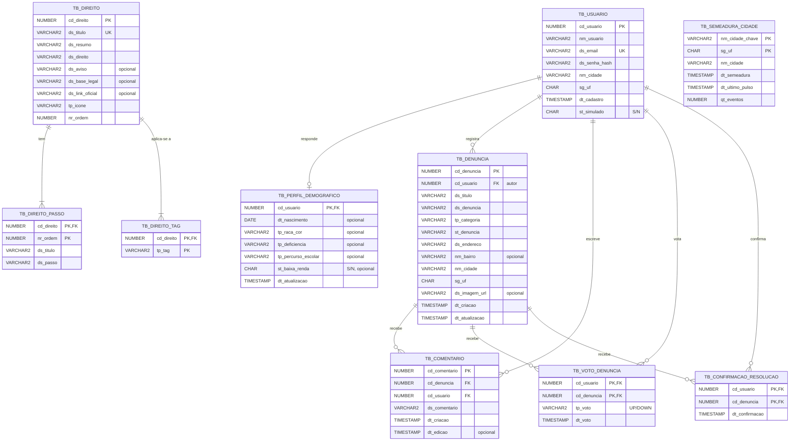

# Modelo de dados (diagrama ER)

Gerado a partir de [`database/script.sql`](../../database/script.sql), que cria estas tabelas no Oracle.
O GitHub desenha o diagrama abaixo direto nesta página.

## Diagrama

`TB_SEMEADURA_CIDADE` não tem chave estrangeira: ela registra quais cidades já receberam o conteúdo de demonstração ("cidade viva") e quando foi o último pulso de atividade. A ligação com usuários e denúncias é pelo nome da cidade e pela UF.

## Regras garantidas pelo banco

| Regra | Como |
|---|---|
| Um e-mail por conta | `UNIQUE (ds_email)` em `tb_usuario` (a API responde 409) |
| Um voto por pessoa em cada denúncia | Chave primária `(cd_usuario, cd_denuncia)` em `tb_voto_denuncia` |
| Uma confirmação de resolução por pessoa | Chave primária `(cd_usuario, cd_denuncia)` em `tb_confirmacao_resolucao` |
| Questionário opcional, no máximo um por usuário | `cd_usuario` é a chave primária e estrangeira de `tb_perfil_demografico` |
| Título de tema sem repetição | `UNIQUE (ds_titulo)` em `tb_direito` (a API também compara sem diferenciar maiúsculas antes de gravar) |
| Uma semeadura por cidade | Chave primária `(nm_cidade_chave, sg_uf)` em `tb_semeadura_cidade` |
| Valores de lista válidos | `CHECK` em categoria, status, voto, raça/cor, deficiência, percurso escolar, ícone e tag, com os mesmos valores dos enums Java (a UF é validada pela API) |
| Passos numerados de 1 a 10 | `CHECK (nr_ordem BETWEEN 1 AND 10)` em `tb_direito_passo` |
| Booleanos | `CHAR(1)` com `CHECK IN ('S', 'N')` |

## Decisões

- **Script que só cria o que falta.** O `database/script.sql` reproduz exatamente as tabelas do schema usado no Oracle da FIAP e nunca apaga nem altera nada: cada tabela, sequence e índice só é criado se ainda não existir, e cada tema do catálogo só é inserido se o título ainda não estiver cadastrado. Assim ele pode rodar num schema compartilhado com outros projetos.
- **Datas com hora em `TIMESTAMP`** com `DEFAULT SYSTIMESTAMP`; a data de nascimento é `DATE`.
- **Textos em `VARCHAR2` com o limite padrão do schema (em bytes).** A API valida os tamanhos em caracteres. Um texto no limite máximo e cheio de acentos pode passar de bytes: nesse caso o Oracle recusa (ORA-12899) e a API responde 400 indicando o campo.
- **Sem `ON DELETE CASCADE`.** A API apaga as tabelas filhas antes da tabela mãe, na mesma transação. Se algo escapar, o Oracle recusa a exclusão (ORA-02292) e a API responde 409 em vez de apagar dados em silêncio.
- **Chaves geradas por sequence** (`seq_usuario`, `seq_denuncia`, `seq_comentario`, `seq_direito`), usadas pela API com `NEXTVAL`.
- **Cidade guardada como texto.** A comparação ignora acentos, maiúsculas e espaços repetidos (`TRANSLATE(UPPER(...))` nas consultas). O próximo passo seria uma tabela de municípios do IBGE (ver as limitações no [README do back-end](../../backend/README.md#6-limitações-conhecidas)).
