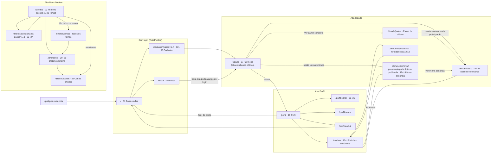
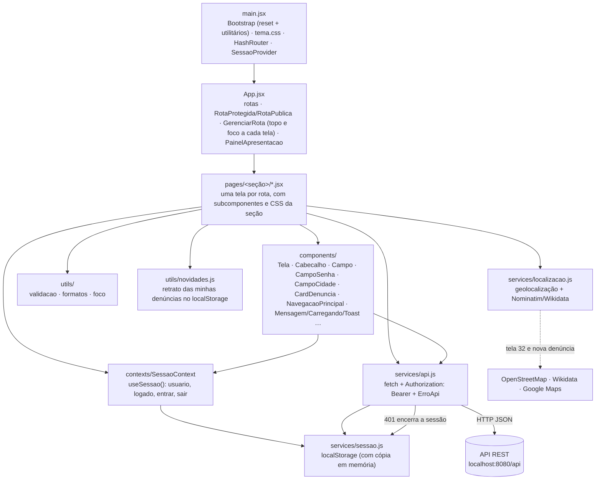

# Diagrama do front-end

Gerado a partir do código em `frontend/src` (rotas em `App.jsx`). O GitHub desenha os diagramas abaixo direto nesta página.

O diagrama está dividido em duas partes:
1. **Telas e navegação:** as rotas, os números das telas do Figma e por onde a pessoa passa.
2. **Camadas:** como uma tela chega à API.

A tabela completa de rotas (com o arquivo de cada tela) e as capturas estão no [README do front-end](../../frontend/README.md).

## 1. Telas e navegação

> **Fluxos recentes:** no feed, a busca e os filtros de categoria e situação trocam as abas por `GET /denuncias` com filtros (e voltam iguais do detalhe); o "Ver painel completo" leva ao Painel da cidade (relatórios da API). Na nova denúncia, "Usar minha localização" preenche endereço e bairro. Ao abrir "Minhas denúncias", cada card mostra o que mudou desde a última visita (o Perfil mostra quantas têm novidades). No detalhe, "Compartilhar" usa o menu do sistema, copia o link ou o mostra num campo, e cada comentário de outra pessoa pode ser denunciado.

> Todas as telas logadas ficam dentro de `RotaProtegida`; as telas de aba mostram a navegação principal (Cidade · Meus Direitos · Perfil). A aba Cidade fica ativa em `/cidade/*` e `/denuncias/*`, e a aba Perfil em `/perfil/*` e `/minhas`. Sem sessão, a rota protegida leva para "Entrar" (e volta à tela pedida depois do login); depois de sair ou excluir a conta, leva para as boas-vindas. Quem já está logado e abre uma rota pública vai para `/cidade`. As etapas do cadastro, da nova denúncia e do questionário ficam na URL (`?passo=`; no questionário, também `&lista=` para as listas 24, 26 e 27), por isso o "voltar" do celular volta uma etapa.

## 2. Camadas

| Pasta | Responsabilidade |
|---|---|
| `pages/` | Uma pasta por seção do Figma (`inicio`, `cidade`, `denuncias`, `perfil`, `direitos`), com as telas, os subcomponentes e o CSS de cada uma |
| `components/` | Peças reutilizadas em várias telas, sem regras de uma tela específica (inclui as guardas de rota, o `GerenciarRota` e o `PainelApresentacao`) |
| `services/` | Comunicação com a API (`api.js`), sessão do usuário (`sessao.js`) e localização (`localizacao.js`: navegador e OpenStreetMap) |
| `contexts/` | Estado global de sessão (`useSessao()`) |
| `utils/` | Funções puras: validação (as mesmas regras do back-end), formatação, foco e novidades das minhas denúncias (`novidades.js`, com o retrato no `localStorage`) |
| `styles/tema.css` | Tokens e classes do Figma, larguras (celular, folha, painel), movimento e acessibilidade |
