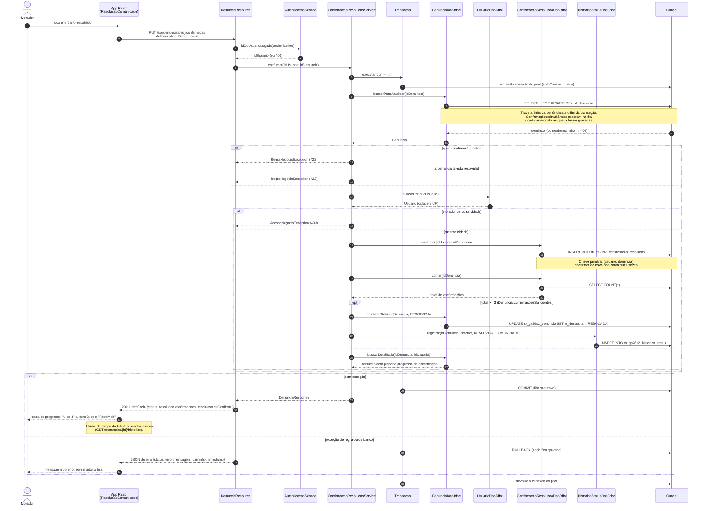

# Diagrama de sequência · confirmar que foi resolvido

Gerado a partir do código: `ResolucaoComunidade.jsx` (front), `DenunciaResource.confirmarResolucao`, `ConfirmacaoResolucaoService.confirmar` e os DAOs JDBC (back-end).
O GitHub desenha o diagrama abaixo direto nesta página. A versão em imagem está em [`diagrama-sequencia-confirmacao.svg`](diagrama-sequencia-confirmacao.svg), nesta mesma pasta.

É a regra mais característica do Meus Direitos: o autor não decide sozinho que o problema acabou. Quando **3 moradores diferentes da mesma cidade** confirmam no detalhe da denúncia que "já foi resolvido", ela passa para `RESOLVIDA` sozinha, e a linha do tempo registra que a mudança veio da comunidade.

## Diagrama

## Como ler

- **Tudo numa transação.** `Transacao.executar` abre a conexão, roda o bloco e faz `COMMIT` se nada falhar ou `ROLLBACK` se qualquer exceção subir. Gravar a confirmação, mudar a situação e registrar o histórico acontecem juntos ou não acontecem.
- **Por que a trava.** Sem o `FOR UPDATE`, três moradores confirmando no mesmo instante contavam só a própria confirmação (1, 1, 1) e a denúncia nunca chegava a 3. Com a trava, a segunda transação espera a primeira terminar e já enxerga a confirmação gravada. Isso foi conferido disparando três confirmações em paralelo contra a API e o Oracle.
- **Quem pode confirmar.** Moradores logados, da mesma cidade da denúncia (403 para outra cidade), que não sejam o autor (422: ele usa "Marcar como resolvida" em Minhas denúncias, que registra no histórico com origem `AUTOR`).
- **Retirar a confirmação.** `DELETE` na mesma rota segue o mesmo caminho (com a mesma trava), apaga a linha da pessoa e não muda a situação; depois de resolvida, a confirmação não pode mais ser retirada (422).
- **Erros.** As exceções viram o JSON padrão nos mappers de `exception/mapper` (ver a parte 3 do [diagrama de classes](diagrama-classes.md#3-erros-exception)).
