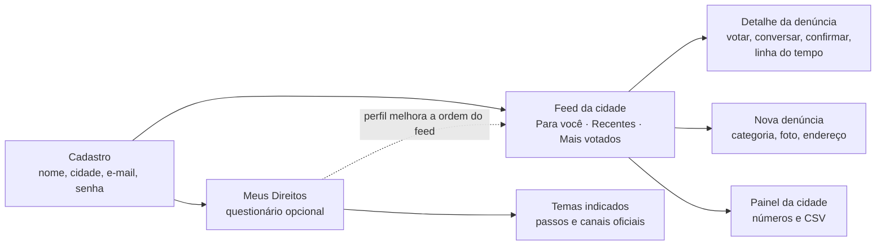
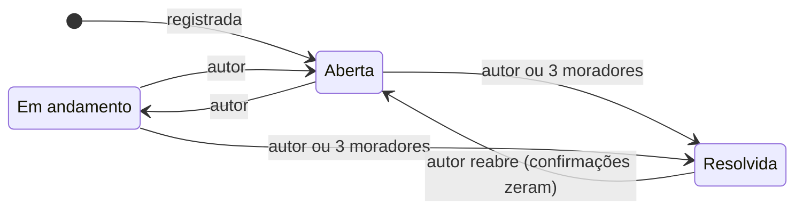

# Visão geral do projeto

O **Meus Direitos** é um app de celular que junta duas necessidades de quem vive numa cidade: **resolver os problemas do bairro em conjunto** e **descobrir quais direitos sociais podem se aplicar a cada pessoa**. Este documento explica o conceito, cada funcionalidade e o motivo de cada escolha. Serve de base para gravar o vídeo pitch e para quem avalia o projeto sem tempo de ler o código.

Para os detalhes técnicos de cada parte, os links no fim levam aos documentos completos.

## 1. O problema e a ideia

| Problema | Resposta do app |
|---|---|
| Buracos, calçadas quebradas e postes apagados são reclamados em canais que ninguém acompanha, e cada morador reclama sozinho. | Um feed da cidade onde cada problema vira uma denúncia pública, que os vizinhos apoiam, comentam e acompanham até ser resolvida. |
| "Resolvido" costuma ser só a palavra de quem responde a reclamação. | A própria comunidade confirma: com **3 moradores** dizendo "já foi resolvido", a denúncia muda de situação, e a linha do tempo registra quem mudou e quando. |
| Quem mais precisa de um direito (gratuidade, atendimento prioritário, cotas, benefícios) costuma ser quem menos sabe que ele existe. | Um questionário opcional indica **possibilidades** de apoio, os passos para buscá-las e os canais oficiais para confirmar. |

O projeto atende aos **ODS 10** (redução das desigualdades) e **11** (cidades e comunidades sustentáveis), dentro do tema CitizenTech da Global Solution 2026/2.

**Uma decisão de princípio:** o app nunca afirma que a pessoa tem um direito. Ele mostra o que pode se aplicar e onde confirmar (prefeitura, Gov.br, CRAS). Prometer um benefício que depois é negado prejudicaria justamente quem o app quer ajudar.

## 2. A jornada de quem usa

As duas metades do app conversam: as respostas do questionário também mudam a ordem do feed. Uma pessoa idosa, por exemplo, vê antes as denúncias de iluminação e calçada.

## 3. Funcionalidades e por que existem

### Cidade

| Funcionalidade | O que faz | Por que foi feita assim |
|---|---|---|
| **Feed "Para você"** | Ordena as denúncias da cidade por relevância: saldo de votos, **+10** se a categoria afeta o perfil de quem lê, **−15** se já foi resolvida. | Cada pessoa vê primeiro o que mais a afeta, sem esconder nada. O cálculo é feito no próprio SQL e é explicável em uma linha. |
| **Abas "Recentes" e "Mais votados"** | Ordem por data e por apoio, iguais para todos. | Alternativas neutras ao feed personalizado. |
| **Busca e filtros** | Texto, categoria e situação, ignorando acentos e maiúsculas ("sao paulo" encontra "São Paulo"). | Quem digita no celular raramente acerta os acentos. |
| **Nova denúncia** | Título, descrição, endereço ("Usar minha localização") e bairro, com telas próprias para escolher a categoria e a foto; gera um **protocolo**. | Escolhas visuais em telas separadas são mais fáceis no celular, o "voltar" não perde o que foi digitado, e o protocolo dá à pessoa algo para citar. |
| **Foto de demonstração** | A pessoa escolhe entre fotos prontas, por categoria. | O protótipo não guarda arquivos: evita armazenamento, conteúdo impróprio e dados pessoais em imagens. |
| **Apoiar ou discordar** | Voto com o placar atualizado na hora (voto otimista: a tela muda antes da resposta da API e volta atrás se ela falhar). | Resposta imediata ao toque; quem escreveu a denúncia não vota nela. |
| **Conversa do bairro** | Comentários com edição e exclusão pelo autor. | Moradores trocam informação sobre o problema ("a prefeitura já veio olhar"). |
| **Moderação** | Termos ofensivos comuns são recusados; com **3 reportes** de pessoas diferentes, o comentário some da conversa sem ser apagado do banco. | A comunidade se protege sem depender de um moderador, e nada é apagado em silêncio. |
| **Resolução pela comunidade** | O autor pode marcar como resolvida; ou **3 moradores da mesma cidade** confirmam "Já foi resolvido" e a situação muda sozinha. | Validação coletiva: ninguém de fora da cidade interfere, e o autor não confirma a própria denúncia. |
| **Linha do tempo** | Mostra quando a denúncia foi registrada e cada mudança de situação, "Pelo autor" ou "Pela comunidade". | Transparência: qualquer pessoa vê como e por quem o problema chegou a "Resolvida". |
| **Compartilhar** | Usa o compartilhar do celular ou copia o link. | Levar a denúncia para fora do app (grupo do bairro, vereador). |
| **Painel da cidade** | Resumo, percentual de resolvidas, denúncias por categoria, bairros com mais problemas e as denúncias com mais participação. | Mostra a cidade em números para moradores e para quem cobra o poder público. |
| **Baixar os números (CSV)** | Gera uma planilha com os números do painel, pronta para o Excel. | Os dados podem ir para uma reunião de bairro ou um ofício à prefeitura. A planilha é montada no próprio navegador, sem rota nova na API. |

O ciclo de vida de uma denúncia:

Cada seta fica gravada na linha do tempo. O caminho completo da confirmação pela comunidade, do toque no botão até o banco, está no [diagrama de sequência](diagramas/diagrama-sequencia-confirmacao.md).

### Meus Direitos

| Funcionalidade | O que faz | Por que foi feita assim |
|---|---|---|
| **Questionário opcional em 3 etapas** | Data de nascimento, raça/cor, deficiência, percurso escolar e CadÚnico. Toda pergunta pode ser pulada e há "Prefiro não informar". | Pedir só o necessário. O app funciona inteiro sem o questionário. |
| **Consentimento (LGPD)** | Os dados sensíveis só são salvos com a caixa de consentimento marcada; a API recusa sem ela. | Raça/cor e deficiência são dados sensíveis pela LGPD e exigem consentimento específico. |
| **Temas indicados** | As respostas viram perfis (pessoa idosa, PCD, jovem, escola pública, CadÚnico...) e o app mostra os temas que se aplicam. | O cruzamento é simples e explicável: cada tema declara a quais perfis se aplica. |
| **Catálogo com todos os temas** | Os 5 temas (transporte e mobilidade, atendimento prioritário, benefícios municipais, educação e cotas, assistência e renda), com filtro por público. | Quem não quer responder o questionário também encontra a informação. |
| **Passos "Por onde começar"** | Cada tema tem passos práticos, base legal e link oficial. | Transformar "você pode ter direito" em "o que fazer amanhã". |
| **Canais oficiais** | Prefeitura da cidade, Gov.br e o CRAS mais próximo, pela localização atual ou pela cidade do cadastro. | O lugar certo para confirmar o direito. A localização fica no navegador: vai só aos serviços de mapa (OpenStreetMap e, ao abrir o link do CRAS, Google Maps), nunca para a API do projeto. |
| **Apagar minhas respostas** | Apaga só o questionário, quando a pessoa quiser. | É o que a caixa de consentimento promete. |

### Conta

| Funcionalidade | O que faz | Por que foi feita assim |
|---|---|---|
| **Cadastro e login** | Primeiro o estado; depois a cidade, com a lista dos municípios daquele estado (em ordem alfabética, refeita a cada letra). Senha de 8 a 64 caracteres com letra e número; sessão de 7 dias. | A cidade sempre existe e é gravada com a grafia oficial, então "jundiai" e "Jundiaí" não viram duas cidades. Regras iguais no app e na API: o erro aparece antes de enviar. |
| **Minhas denúncias com novidades** | Mostra o que mudou desde a última visita ("+2 apoios, +1 comentário, status mudou"). | A pessoa volta ao app para acompanhar a própria denúncia. Fica só no navegador, sem tabela nova. |
| **Editar dados, trocar senha, excluir conta** | A exclusão apaga a conta e tudo o que a pessoa criou. | Direito de eliminação da LGPD. |

### Em todas as telas

- **Acessibilidade:** navegação por teclado e leitor de tela, foco visível, alvos de toque de 44 px, contraste AA, status sempre com texto (não só cor) e respeito a "reduzir movimento".
- **Abre direto do disco:** o `frontend/dist/index.html` funciona com um duplo clique, sem servidor, como a entrega da FIAP pede.
- **Fiel ao Figma da equipe:** cores, tipografia (Inter) e telas seguem o protótipo; as telas a mais (como o Painel) seguem o mesmo estilo.

## 4. "Cidade viva": o app nunca começa vazio

Um app de comunidade sem comunidade não mostra nada. Por isso, a primeira pessoa a se cadastrar numa cidade dispara a criação de **12 moradores e 12 denúncias de exemplo**, com votos, comentários, confirmações e linha do tempo. Depois, ao abrir o feed, se já passaram 10 minutos desde a última vez, surgem de 1 a 3 novidades de exemplo (votos, comentários, confirmações ou uma denúncia nova).

O conteúdo de exemplo é sempre identificado:
- tem o selo **"Exemplo"** no app e a marca `ST_SIMULADO = 'S'` no banco;
- o painel diz quantas denúncias são de demonstração;
- os moradores de exemplo não fazem login, não aparecem em listas públicas e nunca interagem com denúncias de pessoas reais.

Assim, quem avalia vê votos, conversa e resolução funcionando em qualquer cidade, sem ser enganado sobre o que é real.

## 5. Privacidade e segurança

| Cuidado | Como |
|---|---|
| Senha | Guardada só como hash PBKDF2 com salt; ninguém consegue lê-la. |
| Sessão | Token assinado (HMAC-SHA256) que ninguém consegue falsificar sem o segredo do servidor. |
| Tentativas de senha | 5 erros seguidos bloqueiam o login daquele e-mail por 15 minutos. |
| Quais e-mails têm conta | O login responde igual para e-mail inexistente e senha errada. |
| Dados do questionário | Nunca aparecem para outras pessoas nem nos relatórios. |
| Localização | Não passa pela API do projeto. |
| Ataques comuns | SQL sempre com parâmetros, CORS restrito, cabeçalhos de segurança e mensagens de erro sem detalhes internos. |

O detalhe está em [Segurança e privacidade](seguranca-e-privacidade.md).

## 6. Tecnologia e o porquê de cada escolha

A regra da FIAP é usar só as tecnologias da disciplina. Por isso o projeto não usa Spring, JPA, Lombok nem bibliotecas de JWT ou de pool: o que elas fariam foi feito com o próprio Java.

| Parte | Tecnologia | Por quê |
|---|---|---|
| App | React 19, React Router (HashRouter), Bootstrap só no reset, `fetch` | O roteamento com `#` permite abrir o app direto do disco. |
| API | Java 17, JAX-RS (Jersey), Grizzly, JSON-B | Conteúdo da disciplina; camadas `resource → service → dao` separam HTTP, regras e SQL. |
| Banco | Oracle via JDBC, com pool de conexões feito com o JDK | Abrir uma conexão com o Oracle da FIAP custa centenas de milissegundos; o pool reaproveita. |
| Sessão | Token HMAC-SHA256 feito com `javax.crypto` | Sem biblioteca de JWT e sem tabela de sessões. |
| Banco compartilhado | Objetos com o prefixo `GS26S2` e script que só cria o que falta | O mesmo schema tem tabelas de outros projetos, que não podem ser tocadas. |
| Exclusões | Sem `ON DELETE CASCADE`: a API apaga as tabelas filhas antes, na mesma transação | Nada é apagado em silêncio; se algo escapar, o Oracle recusa. |
| Publicação | Render (API, em container Docker) e Vercel (app) | Docker só no deploy, porque o Render não roda Java sem container. O código não depende dele. |

As decisões completas, com o que se abriu mão em cada uma, estão na [Arquitetura](arquitetura.md#5-decisões-de-arquitetura).

## 7. Como o sistema foi verificado

| Verificação | O que cobre |
|---|---|
| Testes de unidade (139) | Regras de negócio, validação, token, configuração, linha do tempo, conteúdo de exemplo. Rodam sem banco. |
| Testes de integração (7) | Os DAOs contra o Oracle de verdade, com tudo desfeito no fim (ROLLBACK). |
| Teste de ponta a ponta (31 verificações) | O fluxo inteiro pela API: cadastro, login, denúncia, votos, comentários, 3 confirmações simultâneas, linha do tempo, relatórios, bloqueio do login, exclusão. Cria e apaga as próprias contas. |
| Teste de estresse (145 casos) | Entradas absurdas, tokens falsos, acessos indevidos e concorrência. Nenhum caso derruba a API ou devolve erro interno. |
| Telas | Testadas a 390 px de largura (celular), com teclado e leitor de tela. |
| CI no GitHub | A cada push, roda os testes e confere se o app versionado está atualizado. |

## 8. Limites conhecidos

Escolhas conscientes de um protótipo, com o próximo passo de cada uma:

- **Lista de municípios em arquivo**, não em tabela: um município criado depois de 2025 exige atualizar o arquivo do IBGE no app e na API.
- **Sem envio de fotos**: só as fotos de demonstração. Próximo passo: armazenamento de arquivos com moderação.
- **Sessão sem revogação individual**: sair apaga o token do aparelho, mas uma cópia valeria até vencer (7 dias). Próximo passo: uma tabela de sessões.
- **Moderação simples**: o filtro é por palavra inteira e não há revisão humana do comentário oculto.
- **API gratuita "dorme"** no Render depois de 15 minutos sem uso; a primeira abertura demora cerca de 1 minuto.

## 9. Perguntas prováveis

**Por que não usar Spring, que seria mais rápido?**
A FIAP só pontua as tecnologias da disciplina. Fazer o pool, a transação e o token com o próprio Java mostrou que a equipe entende o que esses frameworks fazem por baixo.

**O app diz que a pessoa tem direito a um benefício?**
Não. Ele indica possibilidades e leva aos canais oficiais para confirmar. A decisão é do órgão responsável.

**Os dados de exemplo não enganam quem usa?**
Não, porque estão sempre marcados como "Exemplo", e o painel diz quantos são. Eles existem para o app mostrar o seu funcionamento desde o primeiro acesso.

**O que impede uma pessoa de marcar como resolvido um problema de outra cidade?**
A API confere a cidade de quem confirma e recusa (403). O autor também não confirma a própria denúncia, e cada pessoa conta uma vez só.

**E se três pessoas confirmarem ao mesmo tempo?**
A denúncia é travada no banco enquanto cada confirmação é contada, então as três contam certo. O teste de ponta a ponta dispara as três juntas para conferir isso.

**Por que Docker, se não é conteúdo da disciplina?**
Ele só existe para publicar a API no Render. Para rodar e avaliar, basta o Maven, e o código não depende dele.

**Os dados sensíveis do questionário ficam expostos?**
Não. Só são salvos com consentimento, nunca aparecem para outras pessoas nem em relatórios, e podem ser apagados a qualquer momento.

## 10. Para aprofundar

| Documento | Conteúdo |
|---|---|
| [README](../README.md) | Como executar, telas e tecnologias |
| [Roteiro de demonstração](roteiro-demonstracao.md) | Passo a passo do vídeo, com tempos e falas |
| [Arquitetura](arquitetura.md) | Camadas, regras do produto e decisões |
| [Guia da API](api.md) | Todas as rotas, respostas e erros |
| [Banco de dados](banco-de-dados.md) e [diagrama ER](diagramas/diagrama-er.md) | Tabelas, regras e como evoluir o banco |
| [Diagramas](diagramas/) | Classes, sequência da confirmação, ER e telas do front |
| [Segurança e privacidade](seguranca-e-privacidade.md) | LGPD e proteções da API |
| [Deploy](deploy.md) | Publicação no Render e na Vercel |
