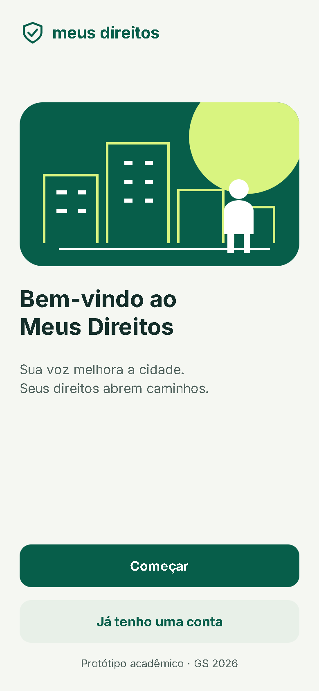
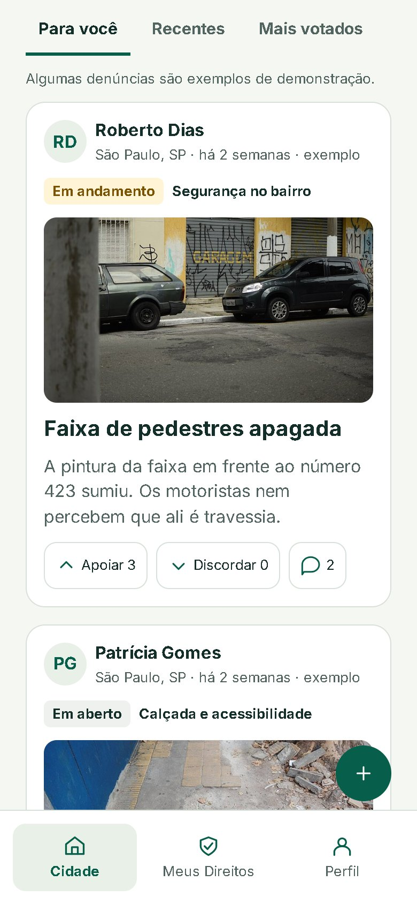
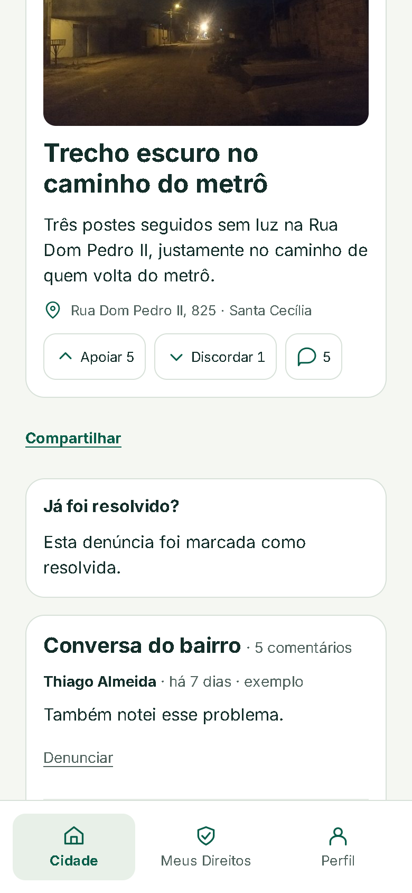
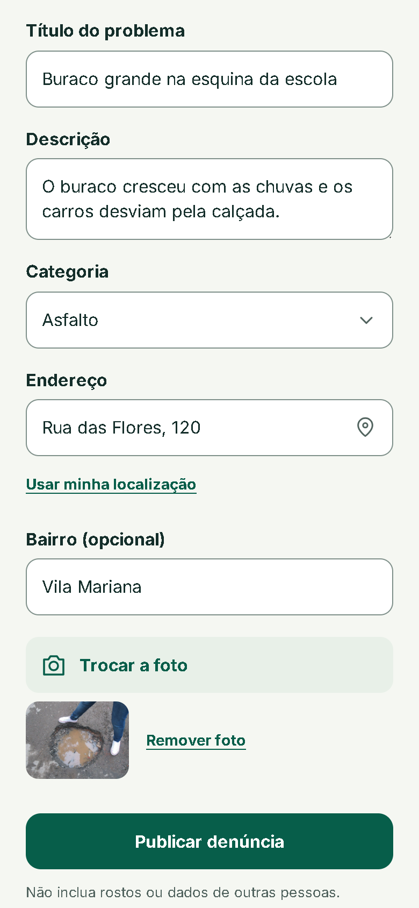
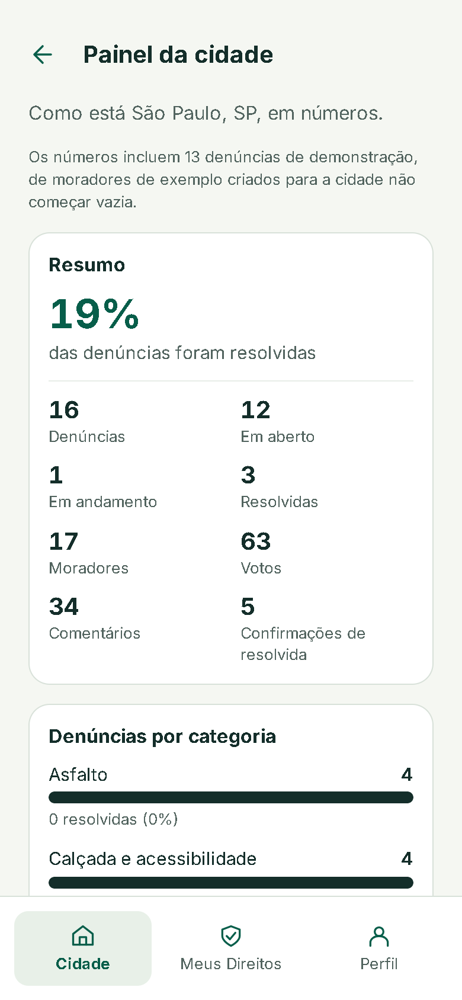
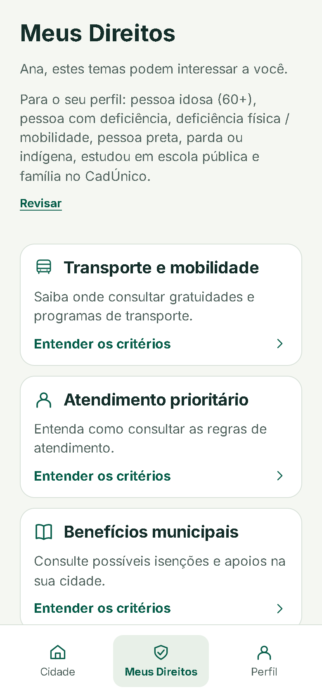
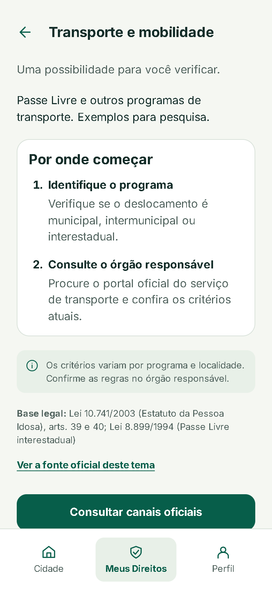
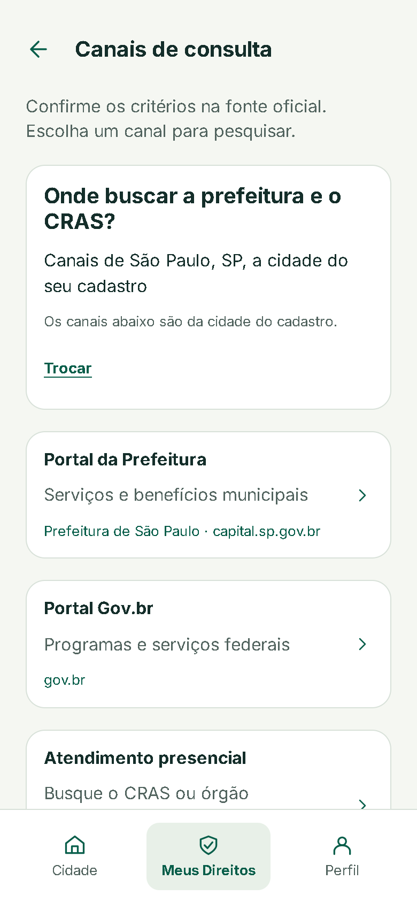
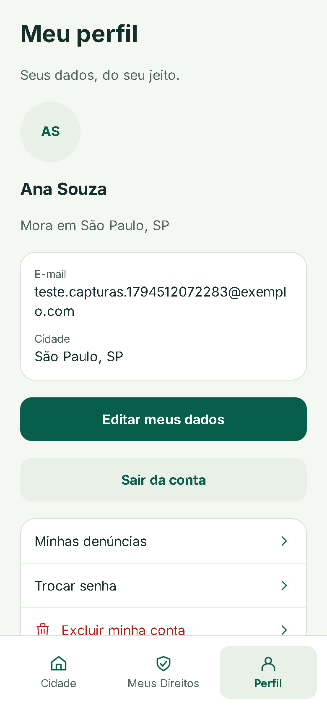
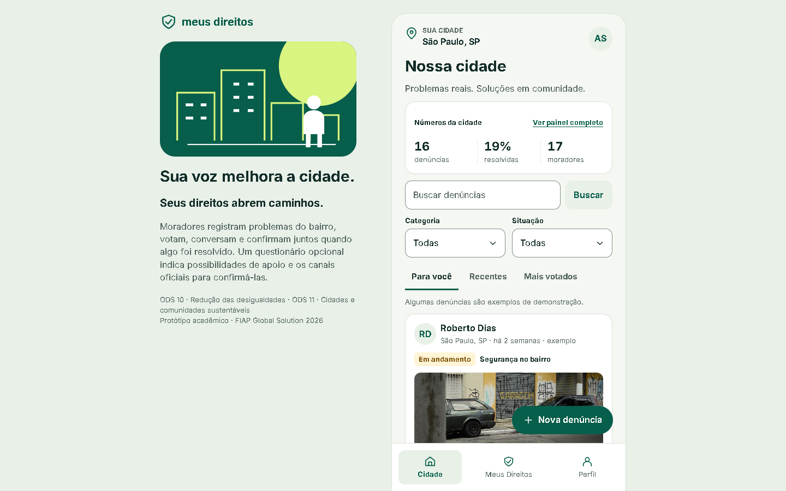

# Meus Direitos · Front-end

Interface web do projeto **Meus Direitos** (FIAP Global Solution 2026/2), feita a partir do protótipo do Figma (33 telas mobile).
Ela consome a API REST do [back-end](../backend/README.md); o contrato está em [`docs/api.md`](../docs/api.md).
O mapa das telas e das camadas está em [`docs/diagramas/diagrama-frontend.md`](../docs/diagramas/diagrama-frontend.md).

## 1. Pré-requisitos

| Ferramenta | Versão |
|---|---|
| Node.js | 20 ou superior (testado com o 24) |
| npm | 10 ou superior |
| API do back-end | rodando em `http://localhost:8080/api` (ver [`backend/README.md`](../backend/README.md)) |

## 2. Como executar

Na pasta `frontend/`:

```bash
npm install
npm run dev
```

Abra `http://localhost:5173`. A API já libera essa origem no CORS.

| Comando | O que faz |
|---|---|
| `npm run dev` | Servidor de desenvolvimento do Vite (porta 5173), com recarga automática |
| `npm run build` | Gera a pasta `dist/` (a versão que abre direto no navegador, ver seção 3) |
| `npm run preview` | Serve a `dist/` gerada, para conferir o build com um servidor |

Para usar outra URL da API, crie um arquivo `.env.local` na pasta `frontend/` (sem ele, o padrão é `http://localhost:8080/api`, definido em `src/services/api.js`):

```properties
VITE_API_URL=http://localhost:8080/api
```

A variável é lida na hora do build: depois de mudá-la, rode `npm run build` de novo para a `dist/` usar o endereço novo.

## 3. Entrega: abrir o `index.html` direto no navegador

O checklist da FIAP pede que o `index.html` abra sem servidor. A pasta **`dist/` já vem pronta no repositório**: com a API rodando, abra `dist/index.html` no navegador (duplo clique).

Depois de mudar o código, gere a `dist/` de novo antes de entregar:

```bash
npm run build
```

Esse caminho foi testado de ponta a ponta com a API e o Oracle reais, abrindo o `index.html` pelo `file://`: cadastro, feed, votos, comentários, resolução, nova denúncia, questionário, canais oficiais e exclusão da conta.

O projeto já está preparado para isso (ver `vite.config.js` e `main.jsx`):
- `base: './'` no `vite.config.js`: todos os caminhos são relativos;
- `HashRouter`: as rotas ficam depois do `#` (`index.html#/cidade`), sem precisar de servidor;
- o build gera **um único script comum** (`format: 'iife'`), porque o navegador recusa `<script type="module">` aberto por `file://`. Um plugin do próprio `vite.config.js` (`abrirDiretoNoNavegador`) troca `type="module" crossorigin` por `defer` no HTML final;
- o CSS sai num arquivo só (`cssCodeSplit: false`), ligado por `<link>`: a tela já aparece estilizada antes de o JavaScript rodar.

**CORS ao abrir por `file://`.** Nesse caso o navegador envia a origem `null`. Inclua `null` na lista de origens da API, no `backend/db.properties`:

```properties
cors.origens=http://localhost:5173,null
```

Isso só é necessário para a avaliação com o `index.html` aberto do disco. A sessão vai num cabeçalho (`Authorization: Bearer <token>`), não num cookie, então liberar `null` não permite que outra página use a sessão de alguém.

## 4. Tecnologias

Apenas o que está no conteúdo do curso:

| Tecnologia | Uso |
|---|---|
| React 19 + Vite | Componentes e build |
| React Router 7 (`HashRouter`) | Navegação entre as telas |
| Bootstrap 5 | Só o reset (`bootstrap-reboot`) e os utilitários de layout (`d-flex`, `gap-*`, `m-*`…); campos, botões e o resto vêm do tema do Figma (`styles/tema.css`) |
| `fetch` | Chamadas à API (sem axios) |

## 5. Telas

Capturas do app rodando com a API e o Oracle reais (celular de 390 × 844 px; a última, num computador). Ficam em [`docs/imagens/telas/`](../docs/imagens/telas/).

| | | |
|---|---|---|
|  Boas-vindas |  Feed |  Detalhe e conversa |
|  Nova denúncia |  Painel da cidade |  Meus Direitos |
|  Tema |  Canais oficiais |  Perfil |



## 6. Rotas

Todas em `src/App.jsx`. Como o roteador é o `HashRouter`, o endereço real fica depois do `#` (ex.: `index.html#/cidade/painel`). Os números são os das telas do Figma.

| Rota | Tela | Login? | Arquivo |
|---|---|---|---|
| `/` | 01 Boas-vindas | não | `pages/inicio/BoasVindas.jsx` |
| `/cadastro?passo=1..4` | 02 Nome → 03 Cidade → 04 E-mail → 05 Senha | não | `pages/inicio/Cadastro.jsx` |
| `/entrar` | 06 Entrar | não | `pages/inicio/Entrar.jsx` |
| `/cidade` | 07 / 33 Feed (estados de voto 08 e 09 no card), com "Números da cidade", busca e filtros | sim | `pages/cidade/Feed.jsx` |
| `/cidade/painel` | Painel da cidade (sem tela no Figma) | sim | `pages/cidade/PainelCidade.jsx` |
| `/denuncias/:id` | 10 Detalhe e conversa · 11 Comentário enviado | sim | `pages/cidade/DetalheDenuncia.jsx` |
| `/denuncias/nova` | 12 Inicial · 13 Preenchida; `?passo=categoria` 14, `?passo=foto` 15, `?passo=publicada` 16 | sim | `pages/denuncias/NovaDenuncia.jsx` |
| `/denuncias/:id/editar` | Mesmo formulário da 12/13, com os dados da denúncia | sim | `pages/denuncias/NovaDenuncia.jsx` |
| `/minhas` | 17 Minhas denúncias · 18 Excluir denúncia | sim | `pages/denuncias/MinhasDenuncias.jsx` |
| `/perfil` | 19 Perfil | sim | `pages/perfil/Perfil.jsx` |
| `/perfil/editar` | 20 Editar · 21 Dados salvos | sim | `pages/perfil/EditarPerfil.jsx` |
| `/perfil/senha` | Trocar senha (sem tela no Figma) | sim | `pages/perfil/TrocarSenha.jsx` |
| `/perfil/excluir` | Excluir minha conta (sem tela no Figma) | sim | `pages/perfil/ExcluirConta.jsx` |
| `/direitos` | 22 Primeiro acesso (sem questionário) ou 28 Temas | sim | `pages/direitos/MeusDireitos.jsx` |
| `/direitos/questionario?passo=1..3` | 23–27 "Sua história" (`&lista=raca\|deficiencia\|percurso` abre as listas 24, 26 e 27) | sim | `pages/direitos/Questionario.jsx` |
| `/direitos/:id` | 29–31 Detalhe do tema | sim | `pages/direitos/DetalheDireito.jsx` |
| `/direitos/canais` | 32 Canais oficiais | sim | `pages/direitos/CanaisOficiais.jsx` |
| qualquer outra | volta para `/` | — | `App.jsx` |

- **Rotas protegidas** ficam dentro de `<RotaProtegida>`: sem sessão, quem saiu por vontade própria ("Sair da conta", conta excluída) vai para `/`; quem perdeu a sessão (401) ou abriu um link sem login vai para `/entrar` e, depois do login, volta à tela pedida.
- **Rotas públicas** ficam dentro de `<RotaPublica>`: quem já está logado vai direto para `/cidade`.
- `/direitos/canais` vem antes de `/direitos/:id` no `App.jsx`, para "canais" não ser lido como id de tema.

## 7. Organização

```
src/
  main.jsx              entrada: reset e utilitários do Bootstrap, tema, HashRouter e SessaoProvider
  App.jsx               mapa de rotas (com o número de cada tela do Figma), moldura e painel de apresentação
  styles/tema.css       tokens (cores, tipografia, medidas, movimento), classes md-*, telas largas e "reduzir movimento"
  services/
    api.js              cliente da API: fetch, token (Authorization: Bearer), erros padronizados (ErroApi), query()
    sessao.js           token e usuário no localStorage (com cópia em memória se o armazenamento estiver bloqueado)
    localizacao.js      geolocalização, Nominatim e Wikidata (canais oficiais e "Usar minha localização")
  contexts/
    SessaoContext.jsx   useSessao(): usuario, logado, entrar, sair
  utils/
    validacao.js        regras dos formulários (as mesmas do back-end) e a lista de UFs
    formatos.js         "há 2 horas", iniciais, "São Paulo, SP", números e plurais
    foco.js             foco no título a cada tela, foco no primeiro erro, rolagem que respeita "reduzir movimento"
    novidades.js        o que mudou nas minhas denúncias desde a última visita
  components/           peças reutilizadas em várias telas (seção 8)
  pages/                uma pasta por seção do Figma, com as telas, os subcomponentes e o CSS de cada uma
    inicio/             01 Boas-vindas, 02–05 Cadastro, 06 Entrar
    cidade/             07–11 e 33: feed (com busca e filtros), detalhe com conversa e resolução, Painel da cidade
    denuncias/          12–18: nova denúncia (categoria, foto, publicada), minhas denúncias, excluir
    perfil/             19–21: perfil e editar; trocar senha; excluir conta
    direitos/           22–32: primeiro acesso, questionário, temas, detalhe do tema e canais oficiais
  assets/
    fontes/             Inter 400 e 700 (woff2) e a licença OFL
    icones/             ícones SVG exportados do Figma
    imagens/            ilustração das boas-vindas e do painel de apresentação
public/img/demo/        fotos de demonstração das denúncias (caminho enviado em imagemUrl) e miniaturas em mini/
dist/                   build pronto para abrir pelo file:// (seção 3)
```

## 8. Componentes compartilhados

Ficam em `src/components/`. Nenhum deles conhece as regras de uma tela específica.

| Componente | O que faz | Quando usar |
|---|---|---|
| `Tela` | `<main class="md-tela">` com margem de 24 px e espaço de 20 px entre os itens; atualiza o título da aba ("Perfil · Meus Direitos"); com `comNavegacao`, mostra a `NavegacaoPrincipal` e reserva espaço para ela | Em volta de toda tela. Props: `titulo`, `comNavegacao`, `gap`, `className` |
| `Cabecalho` | Botão "Voltar" (seta) e o título da tela num `<h1>` que recebe o foco | Telas internas. Sem `voltarPara`, volta no histórico; `aoVoltar` substitui o comportamento (etapas) |
| `NavegacaoPrincipal` | Barra de baixo "Cidade · Meus Direitos · Perfil"; a aba fica ativa em toda a seção (`/denuncias/*` é Cidade, `/minhas` é Perfil) | Não use direto: vem com `<Tela comNavegacao>` |
| `RotaProtegida` / `RotaPublica` | Guardas de rota (seção 6) | Só no `App.jsx` |
| `GerenciarRota` | A cada tela ou etapa nova: rola para o topo e põe o foco no título (no "voltar", a tela cuida da rolagem) | Só no `App.jsx`, uma vez |
| `PainelApresentacao` | Painel "Sobre o projeto" ao lado do app a partir de 1100 px | Só no `App.jsx` |
| `Campo` | Rótulo, entrada (`input`, `textarea` ou `select`), ajuda e erro ligados por `aria-describedby` e `aria-invalid` | Qualquer campo de formulário. Os outros props vão para a entrada |
| `CampoSenha` | Campo de senha com o olho para mostrar ou esconder | Senhas (cadastro, entrar, trocar senha, excluir conta) |
| `CampoCidade` | Cidade com o pin e a lista de estados ao lado (a API pede cidade e UF separados) | Cadastro e editar perfil |
| `Progresso` | Barra de etapas com `role="progressbar"` e "Etapa X de Y" | Cadastro (4 etapas) e questionário (3) |
| `Mensagem` | Alerta no topo de formulários e listas; `tipo="erro"` usa `role="alert"`, os outros `role="status"` | Erro geral da API ou resumo "Confira os campos destacados" |
| `Carregando` (em `Mensagem.jsx`) | Spinner com texto, que só aparece depois de 300 ms | Enquanto uma resposta não chega |
| `Toast` (em `Mensagem.jsx`) | Aviso temporário acima da navegação (3,5 s), entra e sai pela borda de baixo | Confirmações curtas ("Denúncia atualizada.") |
| `CardDenuncia` | Card "MD/Denuncia": autor, selo de status, categoria, foto, título, votos e comentários. Resumo (feed) ou `completo` (detalhe) | Qualquer lista ou detalhe de denúncia. `aoMudarPlacar` avisa a lista quando o voto muda |
| `SeloStatus` (em `CardDenuncia.jsx`) | Selo com a cor do status; "Resolvida" leva um check | Onde aparecer o status fora do card |
| `ImagemDenuncia` | Foto com a proporção reservada (16:9 no feed, 4:3 no detalhe), fade ao carregar e foto padrão da categoria se faltar ou falhar | Dentro do card; use se mostrar a foto em outro lugar |
| `Avatar` | Círculo com as iniciais; com `para`, vira link | Autor de denúncia, topo do feed, perfil |
| `BotaoNovaDenuncia` | Botão flutuante "Nova denúncia", que recolhe para só o "+" enquanto a pessoa rola para baixo | Só no feed |

## 9. Tokens de design

Definidos em `:root` no `src/styles/tema.css`, a partir das variáveis do Figma. Use sempre a variável, nunca o valor solto.

**Cores**

| Token | Valor | Uso |
|---|---|---|
| `--md-verde` | `#075e4a` | Cor da marca: botão principal, links, aba ativa |
| `--md-verde-escuro` | `#064c3c` | Hover do botão principal |
| `--md-tinta` | `#142e2a` | Texto principal e contorno de foco |
| `--md-apagado` | `#52645f` | Texto secundário e legendas |
| `--md-fundo` | `#f5f7f2` | Fundo das telas |
| `--md-suave` | `#e8f0e8` | Botão secundário, selos, avatar, fundo das caixas de informação |
| `--md-suave-escuro` | `#dce8dc` | Hover dos botões claros |
| `--md-branco` | `#ffffff` | Cards e campos |
| `--md-linha` | `#d8e1d9` | Bordas dos cards |
| `--md-linha-suave` | `#e7ede7` | Divisores dentro de listas |
| `--md-borda-campo` | `#7f908a` | Borda dos campos (3,4:1 sobre branco, WCAG 1.4.11) |
| `--md-esqueleto` | `#e3e9e3` | Esqueletos e espaço da foto antes de carregar |
| `--md-erro` / `--md-erro-fundo` | `#b42318` / `#fdecea` | Erros e ações de exclusão |
| `--md-status-aberta-*` | texto `--md-tinta`, fundo `#eef1ee` | Selo "Em aberto" |
| `--md-status-andamento-*` | texto `#7a5200`, fundo `#fff4d6` | Selo "Em andamento" |
| `--md-status-resolvida-*` | texto `--md-verde`, fundo `--md-suave` | Selo "Resolvida" |

**Tipografia** (fonte Inter 400 e 700, em `src/assets/fontes`)

| Classe | Tamanho / peso / altura da linha | Uso |
|---|---|---|
| `.md-titulo` | 28 px · 700 · 1,2 | Título principal da tela |
| `.md-subtitulo` | 20 px · 700 · 1,2 | Título do cabeçalho e de cards |
| `.md-corpo` | 16 px · 400 · 1,45, cor `--md-apagado` | Texto de apoio |
| `.md-corpo-tinta` | 16 px · 400 · 1,5, cor `--md-tinta` | Texto principal de telas de detalhe |
| `.md-negrito` / `.md-campo-rotulo` | 16 px · 700 · 1,2 | Nomes e rótulos de campo |
| `.md-legenda` | 13 px · 400 · 1,45, cor `--md-apagado` | Datas, contadores, observações |
| `.md-sobretitulo` | 12 px · 700, maiúsculas, verde | "SUA CIDADE" (um só no app) |

**Medidas**

| Token | Valor | Uso |
|---|---|---|
| `--md-margem` | 24 px | Margem lateral das telas |
| `--md-espaco-grupo` | 32 px | Separação entre grupos (classe `.md-grupo`, somada aos 20 px do `gap`) |
| `--md-alvo-minimo` | 44 px | Menor alvo de toque |
| `--md-altura-navegacao` | 88 px | Altura da barra de navegação |
| `--md-seguro-baixo` | `env(safe-area-inset-bottom)` | Área segura do iPhone |

Outras medidas fixas do tema: campos e botões com 52 px de altura; raio de 12 px nos campos, 14 px nos botões e 18 px nos cards.

**Movimento** (tudo abaixo de 300 ms na interface)

| Token | Valor | Uso |
|---|---|---|
| `--md-ease-out` | `cubic-bezier(0.23, 1, 0.32, 1)` | Entradas e respostas ao toque |
| `--md-ease-in-out` | `cubic-bezier(0.77, 0, 0.175, 1)` | Reservado para movimentos de um ponto a outro (definido, ainda sem uso no CSS) |
| `--md-dur-toque` | 130 ms | Escala ao apertar um botão |
| `--md-dur-cor` | 150 ms | Troca de cor e borda |
| `--md-dur-media` | 200 ms | Troca de etapa, fade das fotos |
| `--md-dur-tela` | 240 ms | Entrada do toast |
| `--md-dur-celebracao` | 320 ms | Check das telas de confirmação |
| `--md-dur-saida` | 160 ms | Saída do toast (saída mais rápida que a entrada) |

**Larguras**: até 767 px o app ocupa a tela; de 768 px em diante vira uma folha de 430 px com borda e cantos de 28 px; de 1100 px em diante, o `PainelApresentacao` (360 px) aparece ao lado, com 64 px de espaço.

## 10. Como criar uma tela nova

1. **Arquivo.** Crie `src/pages/<seção>/MinhaTela.jsx` na pasta da seção a que ela pertence. Se precisar de estilos próprios, use o CSS da seção (ex.: `perfil.css`) com classes `md-*`, sempre com os tokens da seção 9.
2. **Rota.** Importe a tela no `src/App.jsx` e adicione a `<Route>` dentro de `<RotaProtegida>` (precisa de login) ou de `<RotaPublica>`. Rotas fixas vêm antes das que têm `:id` na mesma pasta. Escreva o número da tela do Figma num comentário, ou "sem tela no Figma".
3. **Moldura.** Envolva tudo em `<Tela titulo="…">`. Tela interna: `<Cabecalho titulo="…" voltarPara="/…" />`. Tela de aba (Cidade, Meus Direitos, Perfil): `<Tela comNavegacao>` e um `<h1 className="md-titulo" tabIndex={-1} data-foco-tela>`. Sem o `data-foco-tela`, o leitor de tela não anuncia a tela nova.
4. **Dados.** Chame a API só por `api()` de `services/api.js` (o token e os erros já vêm tratados) e monte filtros com `query()`. Mostre `<Carregando>` enquanto espera e, no erro, `<Mensagem>{erro.message}</Mensagem>` com um botão "Tentar novamente". O usuário logado vem de `useSessao()`.
5. **Formulário.** Use `Campo`, `CampoSenha` ou `CampoCidade`. Valide antes de enviar com `validarCampos(valores, REGRAS)` de `utils/validacao.js`, mostre "Confira os campos destacados." e chame `focarPrimeiroErro(form)`. Os erros da API chegam por campo com `erro.porCampo()`. Use `<form noValidate>`; `TrocarSenha.jsx` é um bom modelo curto.
6. **Botões e links.** `md-botao md-botao-primario` (uma ação principal por tela), `md-botao-secundario`, `md-botao-perigo` (só na confirmação final de uma exclusão) e `md-acao-texto` para ações em texto.
7. **Etapas.** Se a tela tiver etapas, guarde a etapa na URL (`?passo=`) com `useSearchParams`, para o "voltar" do celular voltar uma etapa, e use `Progresso`.
8. **Navegação.** Se a rota nova pertencer a uma aba com outro prefixo, inclua o prefixo em `ITENS` no `NavegacaoPrincipal.jsx`.
9. **Conferir.** Teste no celular (390 px) e no computador (1100 px ou mais), só com o teclado e com "reduzir movimento" ligado. Atualize a tabela de rotas acima e o [diagrama do front-end](../docs/diagramas/diagrama-frontend.md). Antes de entregar, rode `npm run build` e abra a `dist/index.html`.

## 11. Decisões

- **Fiel ao Figma, com os ajustes combinados no guia da API** (seção 11 do `docs/api.md`): aba "Para você" no feed, cidade e UF separados, endereço e bairro separados, pergunta do CadÚnico no questionário, botões de resolução pela comunidade, "Números da cidade", trocar senha e excluir conta.
- **Validação em JavaScript antes de chamar a API**, com as mesmas regras do back-end. Os erros que ainda vierem da API aparecem ao lado de cada campo.
- **Sessão**: o cadastro e o login devolvem um token assinado pela API (válido por 7 dias). O front guarda o token e o usuário no `localStorage` (chaves `token` e `usuario`) e envia o token no cabeçalho `Authorization: Bearer`. Se o navegador bloquear o `localStorage`, a sessão vale enquanto a página estiver aberta (cópia em memória). Uma resposta 401 encerra a sessão e volta para "Entrar"; o 429 (muitas tentativas de login) aparece na tela de entrar sem apagar o que foi digitado. Login e logout em outra aba também atualizam esta (evento `storage`).
- **Coluna de celular**: o protótipo é mobile (390 px). A partir de 768 px o app aparece como uma folha de 430 px com moldura; a partir de 1100 px, com um painel de apresentação do projeto ao lado.
- **Fonte Inter no próprio projeto** (`src/assets/fontes`, licença OFL): funciona offline e no `file://`, sem enviar o IP de quem usa a terceiros.
- **Acessibilidade**: foco visível em tudo (contorno de 2 px na cor `--md-tinta`, afastado 2 px), a cada tela nova a página volta ao topo e o foco vai para o título, erros de formulário com um resumo único e foco no primeiro campo, alvos de toque de 44 px, contraste AA (inclusive bordas dos campos), campos com 16 px de fonte (o celular não dá zoom ao focar), status sempre com texto (não só cor) e suporte a "reduzir movimento".
- **Apagar as respostas do questionário**: no fim da tela Meus Direitos, "Apagar minhas respostas" pede confirmação na própria tela (foco em "Cancelar") e chama `DELETE /usuarios/perfil`. Também apaga o rascunho do questionário no `sessionStorage` e volta ao primeiro acesso com o aviso "Suas respostas foram apagadas.". É o que a caixa de consentimento promete ("Posso apagá-las quando quiser").
- **Etapas na URL**: cadastro, nova denúncia e questionário guardam a etapa no endereço (`?passo=`), então o "voltar" do celular volta uma etapa.
- **Rascunhos**: o que foi digitado fica no `sessionStorage` (só nesta aba) até terminar: o cadastro guarda nome, cidade, UF e e-mail (**a senha nunca**), a nova denúncia guarda o formulário (a edição não usa rascunho) e o questionário guarda as respostas por usuário (o consentimento não: ele é dado a cada envio).
- **Cache do feed**: cada aba do feed fica guardada em memória enquanto o app está aberto. Ao voltar do detalhe, a lista aparece na hora, na mesma rolagem, e é atualizada em segundo plano. A aba, a rolagem e os filtros ficam no `sessionStorage` (`md-feed-posicao`). Ao trocar de aba, a lista anterior fica esmaecida até a nova chegar.
- **Voto otimista**: ao tocar em "Apoiar" ou "Discordar", o placar muda na hora; a API confirma ou o voto volta ao que era, com a mensagem de erro no card. Tocar no voto atual desmarca. Quem escreveu a denúncia não vota nela.
- **Movimento**: retorno ao toque nos controles (escala de 0,98 nos botões largos), voto que muda na hora, entrada das etapas pela direita (e pela esquerda ao voltar), confirmações com o check e os textos em cascata, toast que entra e sai pela borda de baixo, fade das fotos. Tudo abaixo de 300 ms na interface; hover só em quem tem mouse; com "reduzir movimento", sobram apenas as trocas de cor e opacidade (o spinner continua, mais devagar).
- **Carregamento sem piscar**: o "Carregando…" só aparece depois de 300 ms e os esqueletos são blocos com a altura do conteúdo real, sem brilho animado. A altura das fotos fica reservada antes de elas chegarem.
- **Canais oficiais (tela 32) pela localização**: antes de buscar, a pessoa escolhe entre a **localização atual** (o navegador pede permissão) e a **cidade do cadastro**. A escolha vale para a sessão do navegador (`sessionStorage`) e pode ser trocada na própria tela ("Trocar").
  - *Portal da Prefeitura*: as coordenadas viram cidade e UF no [Nominatim/OpenStreetMap](https://nominatim.org/), que muitas vezes já traz o site oficial do município. Sem ele, o site vem do [Wikidata](https://www.wikidata.org/) (propriedade "site oficial"); sem nenhum dos dois, abre uma busca por "Prefeitura de {cidade}".
  - *Portal Gov.br*: sempre `https://www.gov.br`.
  - *Atendimento presencial*: abre o Google Maps buscando "CRAS" em volta da posição.
  - Com a cidade do cadastro, ou se a localização for negada ou não vier, tudo usa a cidade do cadastro, e a tela explica o motivo.
  - A posição é enviada só ao OpenStreetMap (e, no link do CRAS, ao Google Maps, quando a pessoa clica); nada vai para a API do Meus Direitos. O resultado fica guardado na sessão do navegador para não repetir pedidos (a política do Nominatim é de no máximo 1 por segundo).
- **Painel da cidade** (`/cidade/painel`, sem tela no Figma): aberto por "Ver painel completo" no bloco "Números da cidade". Junta os quatro relatórios da API (`/relatorios/resumo`, `/categorias`, `/bairros?minimo=1`, `/engajamento?limite=5`): resumo com o percentual de resolvidas em destaque, barras por categoria feitas em HTML/CSS (o número vem escrito; a barra é só visual), bairros com mais problemas e as denúncias com mais participação (links para o detalhe). Uma frase diz quantas denúncias são de demonstração (`denunciasSimuladas`). Se o resumo falhar, a tela mostra o erro com "Tentar novamente"; se só um bloco falhar, os outros continuam.
- **Busca e filtros no feed**: texto (até 100 caracteres, aplicado ao tocar em "Buscar"), categoria e situação (aplicadas ao escolher). Com algum filtro ativo, as abas somem e a lista vem de `GET /denuncias?cidade=&uf=&busca=&categoria=&status=` na cidade do usuário, sempre da mais recente para a mais antiga, com o total anunciado ("N resultados"). Sem filtros, o feed continua com as abas. Os filtros e o último resultado ficam guardados como a posição do feed: ao voltar do detalhe, a busca, a lista e a rolagem voltam iguais.
- **"Usar minha localização" na nova denúncia**: só quando a pessoa toca no botão, a posição vira "Rua, número" e bairro pelo Nominatim (reverso, zoom 18). Se a localização for negada ou não vier, aparece uma mensagem curta ao lado do campo e o que já foi digitado fica. A pessoa confere antes de publicar.
- **Foto sem upload**: a API não recebe arquivos (pedido 5 do guia), então a pessoa escolhe uma das fotos de demonstração (tela 15) e o front envia o caminho em `imagemUrl`. Denúncia sem foto mostra a foto padrão da categoria.
- **Conversa do bairro**: quem escreveu um comentário pode editar e excluir; quem está logado pode denunciar o comentário de outra pessoa (`POST /comentarios/{id}/reporte`), com uma confirmação na própria linha.
- **Novidades em "Minhas denúncias"** (sem back-end novo): o app guarda no `localStorage`, por usuário (`md-novidades:<id>`), os números de cada denúncia da última visita (apoios, discordâncias, comentários, confirmações e status). Na visita seguinte, cada card mostra "Novidades: +2 apoios, +1 comentário, status mudou para Resolvida", e o Perfil mostra "N com novidades" na opção "Minhas denúncias" (sem marcar como visto). Fica só neste navegador.
- **Compartilhar denúncia**: no detalhe, usa o menu de compartilhar do sistema quando existe; senão copia o link ("Link copiado."); sem área de transferência (ex.: `file://`), mostra o link num campo para copiar. O link abre a denúncia depois do login.

**O que fica guardado no navegador**

| Chave | Onde | O quê |
|---|---|---|
| `token`, `usuario` | `localStorage` | Sessão |
| `md-novidades:<id do usuário>` | `localStorage` | Retrato das minhas denúncias (novidades) |
| `md-feed-posicao` | `sessionStorage` | Aba, rolagem e filtros do feed |
| `md-cadastro-rascunho` | `sessionStorage` | Rascunho do cadastro (sem a senha) |
| `md-rascunho-denuncia` | `sessionStorage` | Rascunho da nova denúncia |
| `md-questionario-rascunho-<id>` | `sessionStorage` | Rascunho do questionário |
| `md:canais-modo`, `md:canais` | `sessionStorage` | Escolha (localização ou cadastro) e resultado dos canais oficiais |

## 12. Créditos das imagens

As fotos de demonstração das denúncias ficam em `public/img/demo/` (800 px de largura) e as miniaturas da escolha de foto em `public/img/demo/mini/` (400 px). Elas mostram problemas urbanos parecidos com os de cada categoria, mas **não são fotos dos casos registrados no app**: servem só para ilustrar as denúncias de exemplo e a escolha de foto ao criar uma denúncia.

Todas vêm do Wikimedia Commons ou do Flickr, com licença que permite uso, inclusive comercial, desde que o autor seja creditado. 14 das 18 são do Brasil. As fotos foram apenas redimensionadas, sem outras alterações.

| Arquivo | Título original | Autor | Licença | Fonte |
|---|---|---|---|---|
| `asfalto-1.jpg` | Ceará (6276101325) | Agencia CNT de Noticias | [CC BY 2.0](https://creativecommons.org/licenses/by/2.0) | [página (Wikimedia Commons)](https://commons.wikimedia.org/wiki/File:Cear%C3%A1_(6276101325).jpg) |
| `asfalto-2.jpg` | Buraco na rua Licínio Felini- São Paulo | Rodrigo Tetsuo Argenton | [CC BY-SA 3.0](https://creativecommons.org/licenses/by-sa/3.0) | [página (Wikimedia Commons)](https://commons.wikimedia.org/wiki/File:Buraco_na_rua_Lic%C3%ADnio_Felini-_S%C3%A3o_Paulo.JPG) |
| `asfalto-3.jpg` | Acre - BR-317 (pavimento) (8102615312) | Agencia CNT de Noticias | [CC BY 2.0](https://creativecommons.org/licenses/by/2.0) | [página (Wikimedia Commons)](https://commons.wikimedia.org/wiki/File:Acre_-_BR-317_(pavimento)_(8102615312).jpg) |
| `iluminacao-1.jpg` | A lamp post crushed at Avenida Las Delicias, Maracay, Venezuela | Bobjgalindo | [CC BY 4.0](https://creativecommons.org/licenses/by/4.0) | [página (Wikimedia Commons)](https://commons.wikimedia.org/wiki/File:A_lamp_post_crushed_at_Avenida_Las_Delicias,_Maracay,_Venezuela.jpg) |
| `iluminacao-2.jpg` | Rua José Batista à noite, Rio Vermelho, Trindade, novembro de 2019 | Fronteira | [CC BY-SA 4.0](https://creativecommons.org/licenses/by-sa/4.0) | [página (Wikimedia Commons)](https://commons.wikimedia.org/wiki/File:Rua_Jos%C3%A9_Batista_%C3%A0_noite,_Rio_Vermelho,_Trindade,_novembro_de_2019.jpg) |
| `iluminacao-3.jpg` | A fallen street light pole | Niera | [CC BY-SA 4.0](https://creativecommons.org/licenses/by-sa/4.0) | [página (Wikimedia Commons)](https://commons.wikimedia.org/wiki/File:A_fallen_street_light_pole.jpg) |
| `calcada-acessibilidade-1.jpg` | Calçada quebrada | Mílton Jung | [CC BY 2.0](https://creativecommons.org/licenses/by/2.0/) | [página (Flickr)](https://www.flickr.com/photos/22155587@N02/5533517024) |
| `calcada-acessibilidade-2.jpg` | Calçada quebrada na Praça Cidade de Milão | Mílton Jung | [CC BY 2.0](https://creativecommons.org/licenses/by/2.0/) | [página (Flickr)](https://www.flickr.com/photos/22155587@N02/3802112993) |
| `calcada-acessibilidade-3.jpg` | Damaged sidewalk in Montevideo - 02 | NaBUru38 | [CC BY-SA 4.0](https://creativecommons.org/licenses/by-sa/4.0) | [página (Wikimedia Commons)](https://commons.wikimedia.org/wiki/File:Damaged_sidewalk_in_Montevideo_-_02.jpg) |
| `seguranca-1.jpg` | Prédio abandonado no centro histórico de Cananéia | Ferik80 | [CC BY 4.0](https://creativecommons.org/licenses/by/4.0) | [página (Wikimedia Commons)](https://commons.wikimedia.org/wiki/File:Pr%C3%A9dio_abandonado_no_centro_hist%C3%B3rico_de_Canan%C3%A9ia.jpg) |
| `seguranca-2.jpg` | RUA DESERTA | Guilhermedesc | [CC BY-SA 4.0](https://creativecommons.org/licenses/by-sa/4.0) | [página (Wikimedia Commons)](https://commons.wikimedia.org/wiki/File:RUA_DESERTA.jpg) |
| `seguranca-3.jpg` | Rua Dom Joaquim Silvério à noite, Coração Eucarístico, Belo Horizonte, fevereiro de 2023 (1) | Fronteira | [CC BY-SA 4.0](https://creativecommons.org/licenses/by-sa/4.0) | [página (Wikimedia Commons)](https://commons.wikimedia.org/wiki/File:Rua_Dom_Joaquim_Silv%C3%A9rio_%C3%A0_noite,_Cora%C3%A7%C3%A3o_Eucar%C3%ADstico,_Belo_Horizonte,_fevereiro_de_2023_(1).jpg) |
| `limpeza-urbana-1.jpg` | Lixo na calçada da Taquari | Mílton Jung | [CC BY 2.0](https://creativecommons.org/licenses/by/2.0/) | [página (Flickr)](https://www.flickr.com/photos/22155587@N02/6333060344) |
| `limpeza-urbana-2.jpg` | Lixo na calçada | Mílton Jung | [CC BY 2.0](https://creativecommons.org/licenses/by/2.0/) | [página (Flickr)](https://www.flickr.com/photos/22155587@N02/8557470163) |
| `limpeza-urbana-3.jpg` | Lixo Nas Ruas - Marabá - Pa - panoramio | FernandoSantos | [CC BY-SA 3.0](https://creativecommons.org/licenses/by-sa/3.0) | [página (Wikimedia Commons)](https://commons.wikimedia.org/wiki/File:Lixo_Nas_Ruas_-_Marab%C3%A1_-_Pa_-_panoramio.jpg) |
| `outros-1.jpg` | Enorme raiz de uma árvore caida na praça - panoramio | Paulo Humberto | [CC BY-SA 3.0](https://creativecommons.org/licenses/by-sa/3.0) | [página (Wikimedia Commons)](https://commons.wikimedia.org/wiki/File:Enorme_raiz_de_uma_%C3%A1rvore_caida_na_pra%C3%A7a_-_panoramio.jpg) |
| `outros-2.jpg` | Rua Marcílio Dias, em Porto Alegre, durante a enchente de maio de 2024 | Apesito.nomas | [CC BY-SA 4.0](https://creativecommons.org/licenses/by-sa/4.0) | [página (Wikimedia Commons)](https://commons.wikimedia.org/wiki/File:Rua_Marc%C3%ADlio_Dias,_em_Porto_Alegre,_durante_a_enchente_de_maio_de_2024.jpg) |
| `outros-3.jpg` | A photo of a water leak on Camberwell Place 2022-10-08 9 | Thomas Booker (CoderThomasB) | [CC BY-SA 4.0](https://creativecommons.org/licenses/by-sa/4.0) | [página (Wikimedia Commons)](https://commons.wikimedia.org/wiki/File:A_photo_of_a_water_leak_on_Camberwell_Place_2022-10-08_9.jpg) |

## 13. Uso de IA generativa (front-end)

Usamos o **Claude (Anthropic)**, via **Claude Code**, como apoio no front-end para:
- ler as telas do protótipo no Figma (pelo servidor MCP e pela API REST do Figma) e converter o design em componentes React;
- gerar e revisar o código das telas, dos componentes e da integração com a API;
- auditar a interface com três guias de qualidade (Impeccable, tasteskill e os princípios de interação de Emil Kowalski) e aplicar as correções de acessibilidade, movimento e desempenho;
- buscar as fotos de demonstração em acervos abertos, conferindo licença e crédito de cada uma;
- escrever os testes de ponta a ponta no navegador (contra a API e o Oracle reais) e esta documentação.

O design é da equipe (protótipo da Marcela no Figma) e as mudanças em relação a ele foram aprovadas por ela. Todo o código foi revisado e compreendido pelos integrantes do front-end, e testado de ponta a ponta contra a API e o Oracle da FIAP. As decisões técnicas e as justificativas estão documentadas nesta página.
